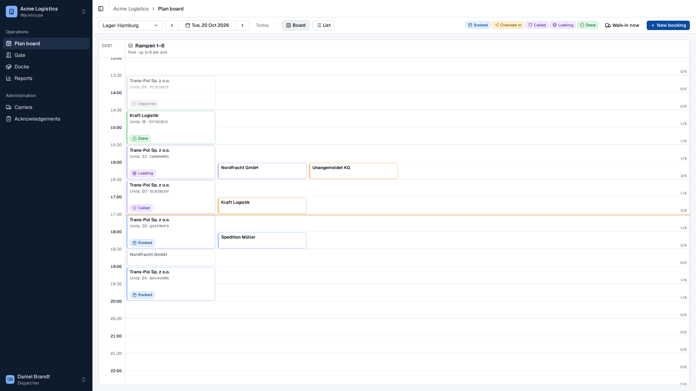
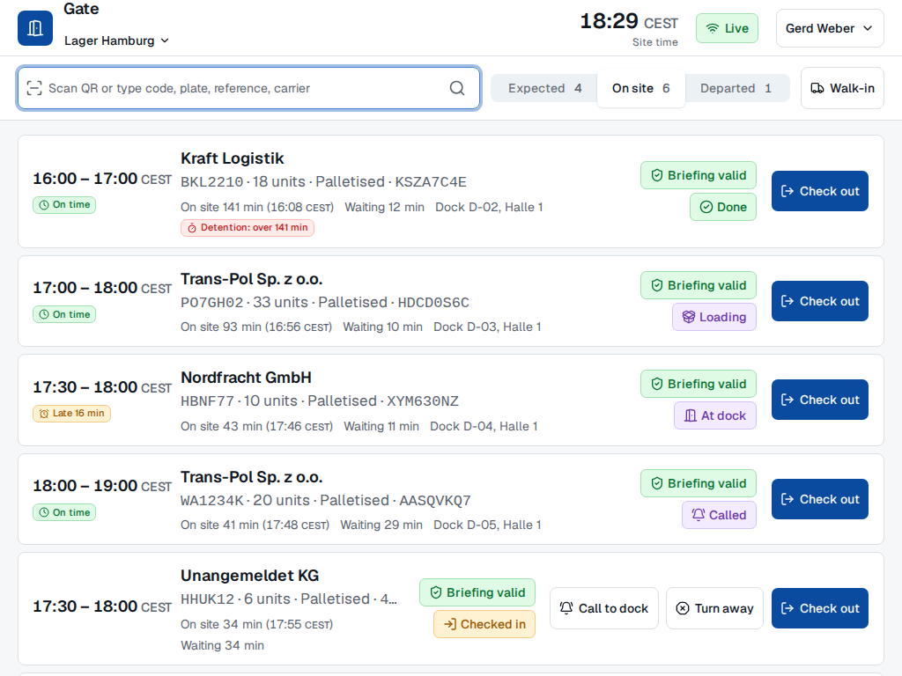
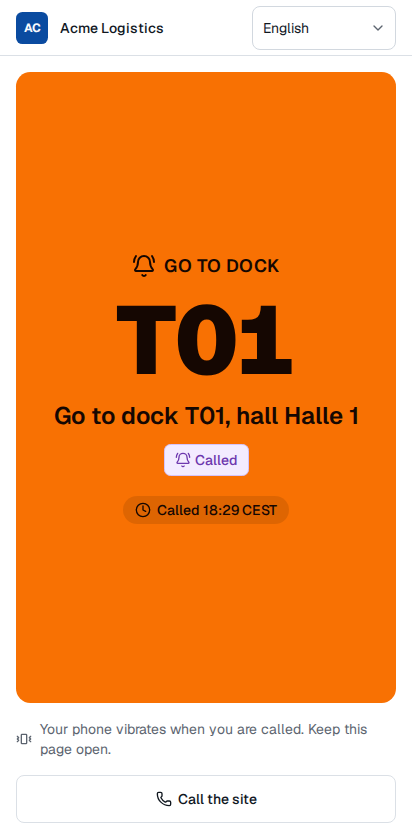

# rampflow

rampflow is a multi-tenant dock and yard management SaaS for small and mid-sized warehouse operators. Carriers book slots at the warehouse's docks and send the avis with the booking, for free. The driver gets one link with the slot, the site's safety briefing in the driver's language, and the call to the dock, while gate and dock staff run the yard from the same booking.



## What each role does

**Platform admin**
- Creates tenants with a package (Start, Pro or Enterprise) and invites their first admin.
- Overrides single entitlements per tenant, with an optional expiry.
- Sets platform defaults for every setting, and sees each tenant's usage against its limits.

**Tenant admin**
- Sets up sites, halls and docks, dock pools, opening hours, closures, public holidays and load types.
- Invites staff with a role and, for gate and dock operators, a list of sites.
- Edits settings per tenant or site, with the source of each value.
- Writes safety briefings in 12 languages, with an optional quiz, and keeps the acknowledgement register.
- Brings in carriers by invitation or by a public booking link per site, uploads the logo, and answers data subject requests.

**Dispatcher**
- Plans the day on the plan board, books, reschedules and cancels for carriers, and books over capacity with a reason.
- Reads the KPIs (punctuality, waiting time, dock time, turnaround, no-shows) and exports them as CSV.

**Carrier**
- Books a slot in four steps (where and what, when, avis, confirmed) at every warehouse that linked it.
- Changes or cancels until the site's cutoff, books again from an earlier booking, and invites colleagues.
- Shares one driver link by copy, email or the phone's share sheet.

**Driver**
- Opens the link without an account or an app, in one of 12 languages.
- Completes the safety briefing before arrival, and sees the call to the dock on the phone.

**Gate operator**
- Checks trucks in by QR code, booking code, plate or reference, with the punctuality and the briefing status.
- Records walk-ins, turns trucks away with a reason, and checks trucks out.

**Dock operator**
- Calls a waiting truck to a free dock, then records docking, loading and completion with the actual load units.





## Quick start

You need Node.js 24, pnpm 12 and Podman with `podman compose`.

```sh
pnpm install
pnpm db:up
pnpm db:setup && pnpm db:migrate
pnpm db:seed
pnpm dev
```

Open <http://localhost:5173> and sign in with a demo account. [Run rampflow locally](docs/how-to/run-locally.md) lists the accounts (password `rampflow-demo`), the ports of a git worktree, and the test commands. To follow one truck through the whole app, take the tutorial [Your first truck, end to end](docs/tutorials/first-truck-end-to-end.md).

## Documentation

[docs/INDEX.md](docs/INDEX.md) lists every doc with a one-line description. The docs follow [Diátaxis](https://diataxis.fr):

- `docs/tutorials/`: guided first runs.
- `docs/how-to/`: recipes for one task each.
- `docs/reference/`: data model, API routes, booking lifecycle, module contract.
- `docs/explanation/`: scope, architecture, glossary, research. Start with the [architecture overview](docs/explanation/architecture-overview.md).
- `docs/decisions/`: the architecture decision records.

Agents start with [AGENTS.md](AGENTS.md).

## Tech stack

| Part | Stack |
|---|---|
| API (`apps/api`) | Node.js 24, Hono 4, Drizzle on node-postgres, zod 4, React Email, nodemailer |
| Database | Postgres 18 with row-level security per tenant and party |
| Back office (`apps/web`) | Vite 8, React 19, TanStack Router and Query, shadcn/ui on Base UI, Tailwind CSS 4, react-hook-form, i18next |
| Driver PWA (`apps/driver`) | Vite 8, React 19, i18next, under `/d` on the same origin |
| Shared (`packages/shared`, `packages/i18n`) | Module manifests, packages, zod schemas, time functions, translation catalogs |
| Tooling | TypeScript 7, pnpm 12 workspaces, Biome, Vitest, Playwright, Mailpit, Podman |

## Scripts

| Command | What it does |
|---|---|
| `pnpm dev` | Runs the API, the web app and the driver app with reload. |
| `pnpm db:up`, `pnpm db:down` | Starts or stops Postgres and Mailpit (Podman). |
| `pnpm db:setup`, `pnpm db:migrate`, `pnpm db:reset` | Creates the app role and the database, applies migrations, or recreates the database. |
| `pnpm db:seed` | Loads the demo data. Idempotent. |
| `pnpm admin:create --email <email> --name <name>` | Creates the first platform admin of a real installation. |
| `pnpm verify` | Lint, typecheck, unit and integration tests, docs check, i18n check. |
| `pnpm test:e2e [spec paths]` | Playwright in the pinned container. |
| `pnpm i18n:derive` | Writes the labels derived from the manifests and the typed web resources. |
| `pnpm docs:index` | Writes `docs/INDEX.md` and the catalog tables of the module contract. |
| `pnpm docs:screens` | Walks the core loop against a running `pnpm dev` and saves the screenshots in `docs/assets/screens/`. |
| `pnpm retention:run` | Applies the retention settings once. Schedule it daily. |
| `pnpm bench` | Runs the availability and KPI benchmarks. |
