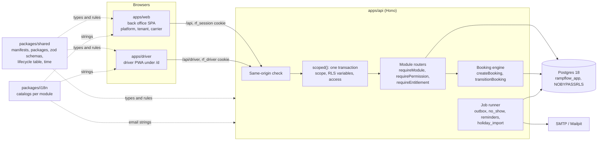

# Architecture overview

rampflow is one TypeScript monorepo with three apps and two shared packages, on one Postgres database. The design has two load-bearing ideas. First, tenant isolation sits in the database: every request runs in one transaction under a role that cannot bypass row-level security. Second, the module manifests in `packages/shared` are the only list of what a tenant can buy and do. Both make the safe path the default one. A handler that forgets a `tenant_id` filter still sees no foreign rows, and a typo in an entitlement key fails the build.

## The parts

- `apps/api` is a Hono server on Node. It serves `/api`, runs the jobs in process, and in production also serves the built `apps/web` at `/` and `apps/driver` at `/d/` (`kernel/static.ts`), so all three share one origin.
- `apps/web` is the back office: one Vite and React SPA with TanStack Router and Query, split into the areas `/platform`, `/t/$orgId` for tenants and `/c/$orgId` for carriers ([ADR-0011](../decisions/ADR-0011-frontend-routes-and-org-context.md)). Gate and dock screens use a station layout for tablets.
- `apps/driver` is a separate PWA, with a budget of 150 KB gzip for its initial JavaScript, because drivers open it on phones at the gate. A driver has no account, only a link ([ADR-0008](../decisions/ADR-0008-driver-token-pwa-delivery.md)).
- `packages/shared` holds what both sides must agree on: the module manifests and packages, the zod schemas of every request and response, the booking lifecycle table, and the time functions for site-local days ([ADR-0012](../decisions/ADR-0012-time-handling.md)).
- `packages/i18n` holds the catalogs, one namespace per module, in three staff locales and twelve driver locales ([ADR-0009](../decisions/ADR-0009-i18n-catalogs.md)).

The web app calls the API through a typed `hc` client built from the API's route types, so a renamed field breaks the web build, not production.

## Every request runs in one scoped transaction

A request passes the same steps in the same order. The same-origin check rejects a mutating request whose `Origin` is neither `APP_ORIGIN` nor one of `APP_EXTRA_ORIGINS` ([ADR-0003](../decisions/ADR-0003-authentication-self-built-sessions.md)). Then `scoped()` (`apps/api/src/kernel/scoped.ts`) resolves the party from the session cookie and the URL: a tenant user at `/t/:orgId`, a carrier at `/c/:orgId`, a driver by its link, and so on. It opens one transaction with `withScope`, which writes the scope into transaction-local settings (`app.party`, `app.tenant_id`, `app.site_ids`, ...). It loads the request's `access`: the role's permissions, the tenant's resolved entitlements and a settings reader. A response of 400 or above rolls the transaction back.

The API connects as `rampflow_app`, which owns no table and cannot bypass RLS. Every table with tenant, carrier or personal data has policies that read those settings ([ADR-0002](../decisions/ADR-0002-tenancy-isolation-rls.md)). Handlers still filter by `tenant_id` or `carrier_id` themselves. RLS is the backstop that turns a missing filter into an empty result instead of a leak.

Two test suites hold this in place. The party matrix in `apps/api/src/db/rls.test.ts` reads every table as every party and compares the rows with an oracle written from [Data model](../reference/data-model.md). The route-case harness calls every route as a foreign tenant, a rival carrier, a gate operator of another site, a role without the permission and a tenant without the entitlement, and `route-coverage.test.ts` fails for a route without a case.

## Module manifests drive entitlements, permissions, settings and navigation

Each of the 12 modules has one `defineModule` manifest in `packages/shared/src/modules/<id>/manifest.ts`. It declares the module's entitlements, permissions with their lowest roles, settings with zod schema, default and scopes, and nav items. `catalog` in `packages/shared/src/registry.ts` lists them in dependency order, and every key type in the code derives from it ([ADR-0006](../decisions/ADR-0006-module-manifest-entitlements-permissions.md)).

From that one source:

- `resolveEntitlements` turns a tenant's package (`packages/shared/src/packages.ts`) and its overrides into the features and limits of each request. A module is off when its `enabledBy` feature or a module it depends on is off.
- `permissionsFor` expands a role through `ROLE_INCLUDES`, so a tenant admin holds every dispatcher permission without a central role table.
- `resolveSetting` resolves a setting site, then tenant, then platform, then the coded default, and reports the source ([ADR-0007](../decisions/ADR-0007-settings-resolution.md)).
- `navFor` builds the sidebar from the nav items the user's permissions and entitlements allow.
- `pnpm i18n:derive` writes the nav, entitlement and setting labels per locale, and `pnpm docs:index` writes the catalog tables of [Module contract](../reference/module-contract.md).

The API enforces with `requireModule`, `requirePermission`, `requireEntitlement` and `withinLimit`. The web app only hides: `guard()`, `useAccess()` and the sidebar read the same keys from the context endpoint. To add a key, follow [Add a module or an entitlement](../how-to/add-a-module-or-entitlement.md).

Packages change with a deploy, not in a database table. That costs a release per pricing change and buys a compiler that rejects a package naming a key no module declares. For a product whose packages change a few times a year, the compiler check is worth more than the deploy it costs.

## The booking engine is the single writer

A booking carries the whole visit, from `confirmed` through `checked_in`, `called`, `at_dock`, `loading` and `done` to `departed`, or to `cancelled`, `no_show` or `turned_away` ([ADR-0005](../decisions/ADR-0005-booking-state-machine.md), [Booking lifecycle](../reference/booking-lifecycle.md)). Two functions in `apps/api/src/modules/booking/lifecycle/` write it:

- `createBooking` takes a transaction-scoped advisory lock per site, reads the load after the lock, and inserts only if the slot still fits ([ADR-0004](../decisions/ADR-0004-booking-capacity-concurrency.md)). Two carriers who race for the last slot get one booking and one 409 with fresh offers. Walk-ins skip capacity.
- `transitionBooking` applies a command from the lifecycle table in `packages/shared/src/modules/booking/lifecycle.ts`. It checks who may run the command in which state, writes the status and its event row in the same transaction, and queues the emails. `single-writer.test.ts` fails when any other code writes `booking.status`.

The gate, the dock, the carrier portal, the plan board and the `no_show` job all go through these two functions. That is why the gate sees the driver's safety briefing, the driver's phone sees the dock call, and the reports find a timestamp for every step: there is one booking row and one event log, not a copy per screen.

## Email goes through an outbox, and jobs run once

A business transaction never talks to SMTP. It calls `enqueueEmail`, which inserts a row into `outbox_message` in the same transaction, so a rolled-back booking sends nothing ([ADR-0010](../decisions/ADR-0010-email-outbox-job-runner.md)). Templates declare a category. `booking` emails need the tenant's `notify.email`, and `account` emails always go out.

The job runner in `apps/api/src/kernel/jobs.ts` finds every `apps/api/src/modules/*/jobs/*.ts` and runs each job on its interval. Each tick takes a `pg_try_advisory_xact_lock` on the job name, so two API instances never run the same tick. The `outbox` job delivers with retries every 5 seconds. `no_show` marks missed slots every minute, and `reminders` sends the carrier a reminder `notify.reminder_hours_before` the slot. `holiday_import` keeps public holidays current. The `retention` job deletes and pseudonymizes personal data. It runs from cron through `pnpm retention:run`, not in process.

There is no queue library and no Redis. Postgres already holds the transaction that decides whether an email exists, and `for update skip locked` is enough for the volume of a warehouse booking system.

## Known security follow-ups

The security review of 2026-10-19 found these low-severity gaps. They are open on purpose: none is reachable without a misconfiguration or a large number of requests, and each needs a decision before it is fixed.

- **Timing of link requests.** `POST /api/auth/magic-link` and `POST /api/auth/password-reset` do two inserts for a known address before the uniform 202, about 2 ms more than for an unknown one. The answer is the same, but the timing can tell whether an account exists. Fix: issue the token and the email in a detached task, or pad the answer to a fixed time.
- **Test routes have no authentication.** `/api/test/*` seeds as the owner role, pins the clock and runs jobs. Startup refuses `ENABLE_TEST_ROUTES=1` in production and when `NODE_ENV` is unset, but a staging host with `NODE_ENV=development` exposes them. Fix: require a shared secret header, or accept test routes only from loopback.
- **SMTP without authentication or required TLS.** `smtpMailer` sends to `SMTP_HOST:SMTP_PORT` with no credentials and only opportunistic STARTTLS. Fix: add `SMTP_USER`, `SMTP_PASSWORD` and `SMTP_REQUIRE_TLS` to `kernel/env.ts`.
- **The seed checks only `NODE_ENV`.** `pnpm db:seed` refuses unless `NODE_ENV` is `development` or `test`. It does not check whether the database already holds a platform admin that is not a demo account.
- **Shared rate-limit keys behind a proxy.** With `TRUST_PROXY=0` behind a reverse proxy, every client has the proxy's address, so `driver_exchange`, `registration_ip` and `login_ip` act as global limits. Fix: warn at startup when `TRUST_PROXY=0` and `APP_ORIGIN` is not localhost.
- **Carrier invitation preview.** The invitation page shows the company name the tenant typed. A carrier admin who accepts links the company they administer, and the tenant sees that company's real name in its carrier list only afterwards. Public-link registrations already show both names before approval.
- **Token and session housekeeping.** Rows in `auth_token` and `session` are never purged. Expiry is checked on every use, so this is storage, not access. A new reset request does not void the older ones. A completed reset voids every unused reset and magic link of the user.
- **Build-time advisory.** `pnpm audit` reports `braces` (GHSA-vfj7-8cjw-p6xm) through the `shadcn` CLI in `apps/web` devDependencies. Nothing ships it.

## Where to read next

| Question | Document |
|---|---|
| Which tables exist and who reads which row? | [Data model](../reference/data-model.md) |
| Which routes exist, with which permission and entitlement? | [API routes](../reference/api-routes.md) |
| Which commands move a booking, and who may run them? | [Booking lifecycle](../reference/booking-lifecycle.md) |
| What does a manifest contain, and what is in each package? | [Module contract](../reference/module-contract.md) |
| Why Drizzle, and how do migrations work on parallel branches? | [ADR-0001](../decisions/ADR-0001-data-access-drizzle-node-postgres.md) |
| How do sessions, passwords and emailed tokens work? | [ADR-0003](../decisions/ADR-0003-authentication-self-built-sessions.md) |
| What does the product do for each role? | [MVP scope](mvp-scope.md) |
