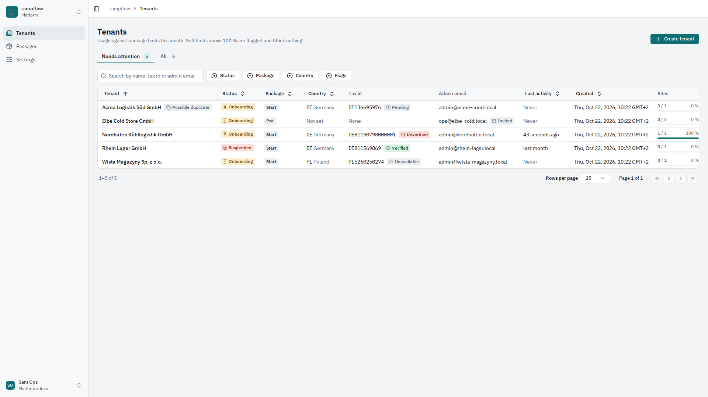
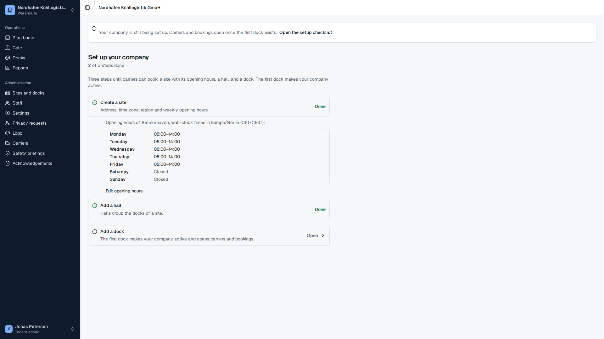

# Onboard a tenant

This guide takes a new warehouse operator from nothing to a working tenant. Steps 1 to 7 need a platform admin account (create the first one with `pnpm admin:create`, see [Run rampflow locally](run-locally.md)). Steps 8 to 11 need the tenant admin account that step 1 invites. A warehouse operator can also register its company itself at `/signup` ([Register your company](register-your-company.md)). Its first admin then starts at step 8, and the platform admin manages the tenant with steps 2 to 7.

## 1. Create the tenant

Most tenants register themselves at `/signup` and appear in the tenant list on their own, with the status **Onboarding**. Create a tenant by hand only for a company that does not register itself:

1. Open **Tenants** (`/platform/tenants`) and select **Create tenant**. A side sheet opens.
2. Enter the company name, choose the package (Start, Pro or Enterprise) and enter the email of the person who will run the tenant.
3. Confirm. The tenant gets the package's entitlements at once, and the admin email receives an invitation that is valid for 7 days. The tenant's hub opens. The tenant has the status **Onboarding**, like a self-registered one. It becomes **Active** when its admin creates the first dock (step 8).

A tenant created by hand has no country. Set it on the hub's Overview (step 2).

If the invitation expires or goes to the wrong address, open the tenant's **Entitlements** tab and send a new admin invitation. A new invitation to the same address replaces the old one, whose link then stops working.

## 2. Find a tenant

**Tenants** (`/platform/tenants`) opens on the view **Needs attention**. It shows the tenants that are onboarding or suspended, flagged as a possible duplicate, or have an unverified tax id. Select **All** to see every tenant. Each tab shows its count.

- **Search.** Type part of the name, the tax id or an admin's email into the search field. Letter case, spaces and separators in a tax id do not matter.
- **Filter.** Use **Status**, **Package**, **Country** and **Flags** (possible duplicate, tax id unverified). Each option shows how many tenants match the search and the other filters. **Clear filters** removes all of them.
- **Order and page.** Select a column header (tenant, created, status, package, country or last activity) to sort by it, and again to reverse. Tenants without a country or without activity come last. The list shows 25 tenants per page; change it under **Rows per page**.
- **Share the view.** The address bar holds the view, search, filters, sort and page. A copied link opens the same list for another platform admin, and the browser's back button returns to the previous list.

Select a row, or **View** in its **…** menu, to open the tenant's hub. The hub has the tabs **Overview**, **Members**, **Sites**, **Entitlements** and **Notes**. The Overview shows the status, the onboarding progress, usage, the tax id with its VIES check, the flags and the admins. To change the name, the country or the package, select **Edit** on the master data card. The country must fit the tenant's tax id. Members and Sites are read-only.

A tenant flagged as a possible duplicate has a link on its Overview that opens the list with the tenant and its possible matches, whatever their status.

## 3. Adjust entitlements with overrides

Packages are fixed in code (`/platform/packages` shows them). For one tenant, an override changes one key:

1. Open the tenant (step 2) and select the **Entitlements** tab.
2. Add an override: choose the key, the value (on or off for a feature, a number or unlimited for a limit), an optional expiry date and a note, for example "trial until end of November".
3. The override applies from the tenant's next request. It can raise or lower the package value. At its expiry it stops applying and the package value returns.

Reserved keys (features that are not built yet) cannot be overridden. Turning a feature off hides its navigation item and its settings for the tenant, and its routes answer 403.

## 4. Set platform defaults

**Settings** (`/platform/settings`) holds the default of every setting with a platform level, for example the retention periods. The settings are grouped in topics (General, Booking, Avis, Safety, Yard, Privacy); select a topic in the list on the left, change the fields, and select **Save**. A tenant or site value always wins over the platform default, so changing a default never overwrites a tenant's own choice. Saving a shorter retention period asks for confirmation first.

**Admitted countries** (`core.site_countries`, topic General) lists the countries a tenant may create sites in; the default is the 27 EU member states. The countries are grouped into **EU member states** and **Other countries**. Check or uncheck a country, or a whole group with its group checkbox. Type in the filter, for example `norw`, to find one country. The list offers Europe, Turkey and the South Caucasus, each with a public holiday calendar, and keeps at least one country. Removing a country blocks new sites there and moving a site there; existing sites keep their country and can still be edited.

## 5. Check usage and activity

The tenant list shows sites, docks, internal users and bookings this month against the package limits, and the last activity of any member. The tenant's Overview shows the same usage meters.

- A soft limit (bookings per month) above 100% is flagged but blocks nothing. Raise it with an override or move the tenant to a larger package. Internal users count members plus invitations that are still open.
- **Last activity** is the latest request of any member, recorded at most every 5 minutes. **Never** means that no member has signed in yet. Sort by it to find tenants that stopped using rampflow.
- The admin email is marked **Invited** while the tenant has only an open admin invitation.

## 6. Suspend or reactivate a tenant

Suspend a tenant that abuses the service, for example with fake bookings or an unpaid account. Suspension deletes nothing and revokes nothing.

1. On the tenant's hub, select **Suspend** in the header, or select **Suspend** in the row's **…** menu in the list. A side sheet opens.
2. Enter the reason (1 to 500 characters) and select **Suspend tenant**.

From the tenant's next request:

- **Tenant staff** see a page that says the organisation is suspended. A member of another tenant keeps working there.
- **Carriers** cannot book, change, cancel or send an avis at the tenant. They still see their bookings there, and their warehouse list marks it **Temporarily unavailable**.
- **Drivers** see the invalid-link screen.
- **Public booking links** show that the link is not available, as for an unknown link.
- **Jobs.** Booking reminders, no-show marking and the holiday import skip the tenant. Retention and queued emails still run.
- **The platform** keeps full access: you can still change the package and overrides, invite admins and add notes.

Every tenant admin whose account is not disabled gets an email with the reason. The reason also goes into the tenant's notes and shows on the Overview.

To reactivate, select **Reactivate** on the hub or in the row's menu, enter a reason and select **Reactivate tenant**. The tenant returns to **Active**, or to **Onboarding** if it had no dock yet. Every session, driver link and public link that has not expired works again, and the tenant admins get an email. Suspending a suspended tenant or reactivating an active one changes nothing and sends no email.

## 7. Keep notes

The **Notes** tab is the platform's internal history of the tenant. Only platform admins see it.

1. Select **Add note**, write the note (up to 2,000 characters) and save it.
2. The note appears at the top with your name and the time.

Suspensions and reactivations add their own entries with the reason. Filter by kind or search the text. Notes cannot be edited or deleted; correct a note with a new one.

## 8. Set up the first dock

A new tenant is in onboarding until its first dock exists. While it is in onboarding, the tenant admin's tenant home opens the checklist **Set up your company** (`/t/<tenant>/onboarding`) with three steps:

1. **Create a site** opens the **New site** form. Enter the address, time zone and region, and confirm or change the weekly opening hours. The preselected template **One shift** opens the site Monday to Friday, 06:00 to 14:00.
2. **Add a hall** opens the site page. Select **New hall** and name it.
3. **Add a dock** opens the site page. In the hall, select **Dock** and enter a code.

Each step shows **Done** or **Open**. A done site step lists the site's opening hours, with **Edit opening hours** to change them. The checklist has no forms of its own. [Set up a site for booking](set-up-a-site.md) describes the site page in detail.

Saving the first dock activates the tenant. The dock joins a pool that is linked to the site's load types, so the site offers start times at once. The checklist then says **Your company is set up**, with the activation date and links to inviting carriers, the public booking link and staff. Activation is one-way. Setting docks inactive later does not return the tenant to onboarding.

Until the first dock exists, every office screen shows a notice that carriers and bookings open once the first dock exists. These actions are disabled, with the reason next to them:

- **Invite carrier** on the carriers page.
- **Create link** on the public links tab.
- **New booking** and **Walk-in now** on the plan board.
- **Walk-in** at the gate.

The API refuses the same actions, and carrier bookings at the tenant, with the error `onboarding_incomplete`. Sites, halls, docks, pools, hours, closures, load types, settings, the logo and staff invitations work during onboarding. You can do steps 9 to 11 before or after the first dock.

## 9. Invite staff

As tenant admin, open **Staff** (`/t/<tenant>/staff`):

1. Invite each person with their email and role: tenant admin, dispatcher, gate operator or dock operator.
2. For gate and dock operators, choose the sites they work at. Without a site list they see every site. An operator limited to one site gets "not found" for everything at the other sites.
3. Change a role or a site list later from the member's row. Removing a member ends their access to this tenant on their next request; their other memberships stay.

At the package's user limit, new invitations are refused until a member leaves, an invitation is revoked, or the limit is raised.

## 10. Configure settings

Open **Settings** (`/t/<tenant>/settings`) for the tenant level. Select a topic in the list on the left, change the fields, and select **Save**; **Discard** undoes the changes. To change one site, open the site under **Sites and docks** and select its **Settings** tab. Every field shows its effective value and, below it, where the value comes from, for example **From platform** or **Set for this tenant**. **Use inherited value** removes the value of the level you are editing when you save, so the field falls back to the next level up. Settings of features outside the package do not appear.

## 11. Upload the logo

Open **Logo** (`/t/<tenant>/brand`) and upload a PNG or JPEG of at most 256 KB. SVG files are refused. The logo appears on carrier booking pages, in emails and in the driver app while the package includes the logo feature.
