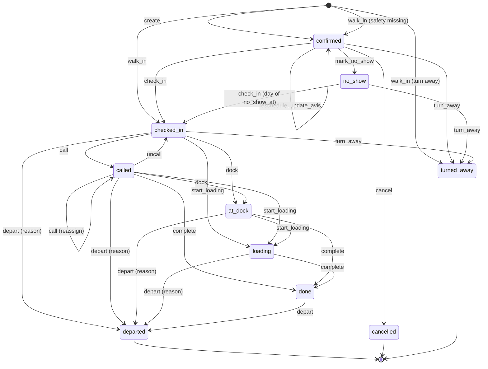

# Booking lifecycle

The booking carries its visit. `transitionBooking` in `apps/api/src/modules/booking/lifecycle/transition.ts` is the only writer of `booking.status` ([ADR-0005](../decisions/ADR-0005-booking-state-machine.md)). The command table below lives as data in `packages/shared/src/modules/booking/lifecycle.ts` (U6a), which the API enforces and the web app reads to offer actions.

## States

| State | Kind | Counts against capacity | Holds a dock | Timestamp column |
|---|---|---|---|---|
| `requested` | reserved for `booking.approval` (LATER); no command reaches it | | | |
| `confirmed` | active | yes | no | `created_at` |
| `checked_in` | active | yes | no | `checked_in_at` |
| `called` | active | yes | yes | `called_at` |
| `at_dock` | active | yes | yes | `at_dock_at` |
| `loading` | active | yes | yes | `loading_at` |
| `done` | active | yes | no | `done_at` |
| `departed` | final | no | no | `departed_at` |
| `cancelled` | final | no | no | `cancelled_at`, `cancelled_late` |
| `no_show` | final; `check_in` on the site-local day of `no_show_at` reopens it | no | no | `no_show_at` |
| `turned_away` | final | no | no | `turned_away_at` |

"Holds a dock" is enforced by the unique index `booking_dock_occupied`. A transition into a dock-holding state needs `dock_id`, given in the command or already assigned.

## Actors

| Actor | Party ([ADR-0002](../decisions/ADR-0002-tenancy-isolation-rls.md)) | Notes |
|---|---|---|
| Carrier | `carrier_at_tenant` | the booking's carrier only; tenant entitlement `booking.carrier_portal` |
| Staff | `tenant` | site-scoped for gate and dock operators |
| Driver | `driver` | the token's booking only |
| System | `tenant` with actor `system:no_show` | the no-show job |

**Booking contact** (who gets booking emails): the carrier user who created the booking; for a staff booking of a linked carrier, every `carrier_admin` of that carrier; nobody for a free-text carrier. Booking emails need `notify.email` ([ADR-0010](../decisions/ADR-0010-email-outbox-job-runner.md)).

**Cutoff**: `starts_at - booking.cancel_cutoff_minutes` of the booking's site, read when the command runs. Carriers act only before it (BK-05). Staff ignore it (BK-03).

**Capacity lock**: commands marked "site lock" call `lockSiteCapacity` before reading load ([ADR-0004](../decisions/ADR-0004-booking-capacity-concurrency.md)).

**Avis module off**: with `avis.basic` off (only by override; every package includes it), `create` and `walk_in` still store the avis that is part of the booking form. Only the separate avis edit routes answer 403.

## Commands

| Command | From | To | Actor and permission | Guards | Side effects | Event | Stories |
|---|---|---|---|---|---|---|---|
| `create` (carrier) | none | `confirmed` | Carrier, `booking.book` | Site lock; active link; load type `carrier_bookable` and active; the start is offered (hours, closures, capacity, daily cap, grid, `booking.min_lead_minutes`, `booking.horizon_days`); avis valid, including `avis.*` settings and `booking.require_plate`; `clientRequestId` unused or same request (checked after the lock) | Issue driver link; email `booking.confirmed` (code, QR, address, slot in site time) to the creator | `created` | BK-04, BK-06, AV-01 |
| `create` (staff) | none | `confirmed` | Staff, `booking.staff_book`; `force: true` needs `booking.force` and a reason | Site lock; open at the start (never forced); capacity and daily cap unless forced; no lead time or horizon; carrier is an active linked carrier or a free-text name | Issue driver link; email `booking.confirmed` to the booking contact | `created` | BK-02 |
| `walk_in` | none | `checked_in`; `confirmed` when check-in's safety guard blocks; `turned_away` with `outcome: 'turn_away'` | Staff, `booking.walk_in` and `yard.gate`. No `booking.force`: gate operators hold `booking.walk_in` | Start is the grid slot that contains `now`. No closed, capacity, daily-cap, lead-time or horizon check: the truck is at the gate. Load type active (need not be `carrier_bookable`); carrier as staff `create`; avis valid as staff `create`, except that a turn-away needs only the plate seen and a reason. Then, in the same transaction, `check_in` (its safety guard included) or `turn_away` | Issue driver link unless turned away; no `booking.confirmed` email | `created` with `walkIn: true`, then `checked_in` or `turned_away` | YD-03, YD-02, BK-02 |
| `reschedule` | `confirmed` | `confirmed` | Carrier before the cutoff with an active link, `booking.book`; staff, `booking.staff_book` (`force` as above) | Site lock; new start fits with this booking excluded; `version` matches | Active driver link `expires_at` becomes the new `starts_at + 7 days`; staff action: email `booking.changed` to the booking contact | `rescheduled` | BK-03, BK-05 |
| `update_avis` | carrier: `confirmed`; staff: `confirmed` to `done` | unchanged | Carrier before the cutoff, `booking.book`; staff, `booking.staff_book` | Avis valid; `version` matches. From `confirmed`, when new load units change the duration: site lock, and the new duration fits at the same start with this booking excluded, else 409 `conflict` reason `capacity_full` and nothing changes. From `checked_in` on, no capacity check: the truck carries what it carries | Staff action on a `confirmed` booking: email `booking.changed` | `avis_updated` | AV-01, AV-02 |
| `cancel` | `confirmed` | `cancelled` | Carrier before the cutoff, `booking.book`; staff, `booking.staff_book` | none beyond source state | Stamp `cancelled_late = (now >= cutoff)`; capacity freed by the state; revoke driver link; staff action: email `booking.cancelled` to the booking contact | `cancelled` | BK-03, BK-05 |
| `regenerate_driver_link` | any active state | unchanged | Carrier, `booking.book`; staff, `booking.staff_book` | none | Revoke the current `link` access, issue a new one | `driver_link_regenerated` | CR-06 |
| `send_driver_link` | any active state | unchanged | Carrier, `booking.book`; staff, `booking.staff_book` | Valid email; locale is one of the 12 | Email `driver.link` in the chosen locale | `driver_link_sent` | CR-06 |
| `mark_no_show` | `confirmed` | `no_show` | System `no_show` | The tenant's `yard` module is on; `now >= starts_at + yard.no_show_after_minutes` | Email `booking.no_show` to the booking contact | `no_show` | BK-08 |
| `check_in` | `confirmed`, `no_show` | `checked_in` | Staff, `yard.gate` | From `no_show` only while `siteDay(now) = siteDay(no_show_at)` in the booking's zone, so a 23:30 slot marked at 00:30 can still check in that next day. No capacity lock. Safety: when `safety.gate_enforcement` is on and `safety.require_for_checkin` resolves `true`, every published instruction that applies to the site has a valid acknowledgement linked to this booking; otherwise missing links only warn | Store `plate_seen` in the avis; compute punctuality with `yard.early_tolerance_minutes` and `yard.grace_minutes` (walk-ins: none) | `checked_in` | YD-02, YD-03 |
| `turn_away` | `confirmed`, `no_show`, `checked_in` | `turned_away` | Staff, `yard.gate` | Reason is one of `safety_not_completed`, `no_capacity`, `too_late`, `documents_missing`, `wrong_load`, `damaged`, `other` | Driver link expires at `min(now + privacy.retention.driver_link_hours, starts_at + 7 days)` | `turned_away` | YD-02, YD-03 |
| `call` | `checked_in`, `called` | `called` | Staff, `yard.call`; entitlement `yard.call_to_dock` | Dock is `active` and on the booking's site; dock holds no other truck (409 `conflict` reason `dock_occupied`); from `called` this is a reassignment | The driver PWA shows the call on its next poll | `called`, or `reassigned` from `called` | YD-07, DR-03 |
| `uncall` | `called` | `checked_in` | Staff, `yard.call`; `yard.call_to_dock` | none beyond source state | Clear `dock_id` and `called_at`, which frees the dock; the driver PWA shows "wait" on its next poll | `uncalled` | YD-07 |
| `dock` | `checked_in`, `called` | `at_dock` | Staff, `yard.dock`; `yard.call_to_dock` | Dock given or already assigned, and free | none | `at_dock` | YD-08 |
| `start_loading` | `checked_in`, `called`, `at_dock` | `loading` | Staff, `yard.dock`; `yard.call_to_dock` | As `dock` | none | `loading_started` | YD-08 |
| `complete` | `called`, `at_dock`, `loading` | `done` | Staff, `yard.dock`; `yard.call_to_dock` | `actualLoadUnits` is an integer of at least 0 | Dock freed by the state; store `actual_load_units` and `discrepancy_note` | `done` | YD-08 |
| `depart` | `checked_in`, `called`, `at_dock`, `loading`, `done` | `departed` | Staff, `yard.gate` | A reason is required unless the source state is `done` | Driver link expires at `min(departed_at + privacy.retention.driver_link_hours, starts_at + 7 days)`; dock freed | `departed` | YD-05 |
| `link_acknowledgement` | `confirmed`, `no_show`, `checked_in` | unchanged | Staff, `yard.gate` (lookup by driver name); driver (after completion, or by safety pass in `GET /api/driver/briefings`) | The acknowledgement belongs to the tenant, its instruction applies to the site, its version is not superseded by a later `material_change` version, it is not restricted, and it is unexpired (or per visit and made for this booking) | Upsert `booking_acknowledgement` | `safety_linked` | YD-02, SF-04 |

Skipped states keep a NULL timestamp (YD-08). Idempotent retries of a command whose target state and input already match answer 200 without a new event; other source-state mismatches answer 409 `conflict` with reason `invalid_transition` and `details.status`.

`uncall` exists for a called driver who never arrives: without it the dock stays held, and the only exits (reassign, depart) either hold another dock or end the visit. A wrong check-in has no undo in the MVP; the check-in dialog asks for an explicit "Check in now".

## Events

`booking_event.data` is a zod discriminated union on `type`, defined next to the command table. Event payloads never contain personal data; the avis holds that.

| Type | `data` |
|---|---|
| `created` | `{ resourceId, startsAt, endsAt, blocksUntil, loadTypeId, loadUnits, createdParty, walkIn, forced, forceReason: string \| null }` |
| `rescheduled` | `{ from: { resourceId, startsAt, endsAt }, to: { resourceId, startsAt, endsAt }, forced, forceReason: string \| null }` |
| `avis_updated` | `{ fields: string[], durationChanged: boolean }` (field names, never values) |
| `cancelled` | `{ reason: string \| null, late: boolean }`; `late` repeats `booking.cancelled_late` |
| `driver_link_regenerated` | `{}` |
| `driver_link_sent` | `{ locale }` |
| `no_show` | `{ dueAt }` |
| `checked_in` | `{ punctuality: 'early' \| 'on_time' \| 'late' \| null, punctualityMinutes: number \| null, plateRecorded: boolean, safety: 'valid' \| 'missing_warned' \| 'not_required', fromNoShow: boolean }` |
| `turned_away` | `{ reason, fromStatus }` |
| `called` | `{ dockId, outsideResource: boolean }` |
| `reassigned` | `{ fromDockId, toDockId, outsideResource: boolean }` |
| `uncalled` | `{ dockId }` |
| `at_dock`, `loading_started` | `{ dockId }` |
| `done` | `{ dockId, actualLoadUnits, discrepancy: boolean }` |
| `departed` | `{ fromStatus, reason: string \| null }` |
| `safety_linked` | `{ instructionId, acknowledgementId, via: 'completed' \| 'pass' \| 'gate_lookup' }` |

Every row also stores `at`, `actor_party`, `actor_user_id` or `actor_job`, `from_status` and `to_status`. Only `tenant_admin` (`booking.view_actors`) sees actor identities (YD-08, works council rule); everyone else sees the event without the actor.

## Punctuality

With `e = yard.early_tolerance_minutes`, `g = yard.grace_minutes` and `m = minutes(checked_in_at - starts_at)`:

- `early` when `m < -e`
- `late` when `m > g`
- `on_time` otherwise

`punctuality_minutes = m`. A check-in from `no_show` is `late`. A walk-in has no slot to be punctual for, so both columns stay NULL.

## KPIs

RP-01 reads only booking columns, so the 90-day query stays one indexed scan, and event retention cannot change a KPI. A visit missing a timestamp is left out of the KPIs that need it. These definitions are binding for U11 and win over any other wording.

**Period.** The filter's site-local dates become one instant range for the site ([ADR-0012](../decisions/ADR-0012-time-handling.md)). A booking belongs to the period when its `starts_at` is in the range. Resource and carrier filters apply to `booking.resource_id` and `booking.carrier_id`.

**Bookings due**: in the period, `starts_at <= now`, `walk_in = false`, and not cancelled before the cutoff (`not (status = 'cancelled' and cancelled_late = false)`).

| KPI | Definition |
|---|---|
| No-show rate | due with `no_show_at is not null` / due |
| Late-cancellation rate | due with `cancelled_late = true` / due |
| On-time rate | `punctuality = 'on_time'` / arrived, where arrived is `checked_in_at is not null and walk_in = false`; early and late reported apart the same way |
| Wait | mean of `at_dock_at - max(checked_in_at, starts_at)` over visits with both timestamps |
| Dock dwell | mean of `done_at - at_dock_at` over visits with both |
| Turnaround | mean of `departed_at - checked_in_at` over visits with both |
| Dock utilisation | sum of `done_at - at_dock_at` / (active docks × open minutes). Active docks: the site's docks with status `active` (with a resource filter, its member docks). Open minutes: the site's weekly hours over the period's local days, minus site closures, holiday closures only while `booking.close_on_public_holidays` is on |
| Portal adoption | `created_party = 'carrier'` / all bookings in the period, cancelled and walk-ins included |
| Standgeld visits | count of visits whose turnaround exceeds the site's `yard.standgeld_flag_minutes` |

- **Which definition wins.** The market research KPI table defines a no-show as "no gate-in by slot end plus grace". The scope's BK-08 fixes the deadline as `starts_at + yard.no_show_after_minutes`, and the no-show job stamps `no_show_at` at that deadline and emails the carrier. The KPI uses BK-08's deadline, so the job, the email and the dashboard agree. A truck that checks in later (YD-02) keeps `no_show_at`: it counts as a no-show here and as a late arrival in the on-time rate, as the market definition implies.
- **Late cancellation** follows the market research ("cancelled after the cutoff in force at that time"). `cancel` stamps `cancelled_late` with the site's cutoff at that moment, so a later settings change does not rewrite history.
- **Format.** Rates are percentages and durations are mean minutes, both rounded to one decimal, half away from zero. An empty denominator gives `null`, shown as "–".

### Reference fixture

U11's RP-01 test seeds exactly these 10 bookings and asserts these values. Site in Europe/Berlin, period 2026-11-10 (CET, UTC+1), `now` 2026-11-11 08:00. Settings: early tolerance 30, grace 15, no-show after 60, Standgeld 120, cancel cutoff 120 minutes. The site is open 06:00 to 22:00 (960 minutes) with no closures and has two active docks. All times are local.

| Visit | Party | Start | Recorded | Status at `now` |
|---|---|---|---|---|
| V1 | carrier | 08:00 | check-in 07:50, at dock 08:05, done 08:50, departed 09:00 | `departed` |
| V2 | carrier | 09:00 | check-in 08:20, at dock 09:10, done 10:00, departed 10:15 | `departed` |
| V3 | staff | 10:00 | check-in 10:30, called 10:35, at dock 10:40, loading 10:45, done 11:40, departed 12:45 | `departed` |
| V4 | carrier | 11:00 | no-show 12:00, check-in 12:30, at dock 12:40, done 13:20, departed 13:30 | `departed` |
| V5 | carrier | 12:00 | no-show 13:00 | `no_show` |
| V6 | carrier | 13:00 | cancelled 12:00 (after the 11:00 cutoff) | `cancelled`, late |
| V7 | carrier | 14:00 | cancelled 08:00 (before the 12:00 cutoff) | `cancelled` |
| V8 | staff | 15:00 | check-in 14:55, loading 15:05 (no at dock), done 15:45, departed 15:50 | `departed` |
| V9 | staff walk-in | 16:00 | check-in 16:10, at dock 16:20, done 17:00, departed 17:10 | `departed` |
| V10 | carrier | 17:00 | check-in 16:50, at dock 17:00, done 17:30 | `done` |

| KPI | Expected | Working |
|---|---|---|
| Bookings due | 8 | all but V7 (cancelled in time) and V9 (walk-in) |
| No-show rate | 25.0 % | V4, V5 of 8 |
| Late-cancellation rate | 12.5 % | V6 of 8 |
| On-time, early, late | 50.0 %, 16.7 %, 33.3 % | arrived V1, V2, V3, V4, V8, V10; on time V1, V8, V10; early V2; late V3, V4 |
| Wait | 7.5 min | V1 5, V2 10, V3 10, V4 10, V9 10, V10 0; V8 has no at-dock time |
| Dock dwell | 44.2 min | 45, 50, 60, 40, 40, 30 over V1, V2, V3, V4, V9, V10 |
| Turnaround | 82.5 min | 70, 115, 135, 60, 55, 60 over V1, V2, V3, V4, V8, V9; V10 has not departed |
| Dock utilisation | 13.8 % | 265 / (2 × 960) |
| Portal adoption | 70.0 % | 7 carrier bookings of 10 |
| Standgeld visits | 1 | V3 (135 minutes) |
