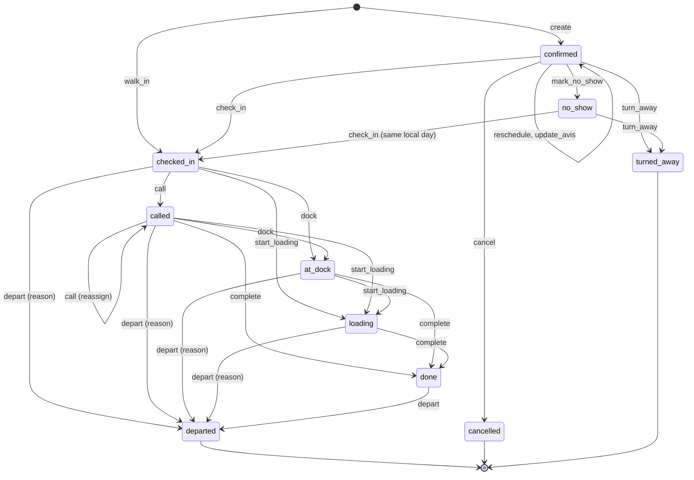

# Booking lifecycle

The booking carries its visit. `transitionBooking` in `apps/api/src/modules/booking/lifecycle/transition.ts` is the only writer of `booking.status` ([ADR-0005](../decisions/ADR-0005-booking-state-machine.md)). The command table below lives as data in `packages/shared/src/modules/booking/lifecycle.ts` (U6), which the API enforces and the web app reads to offer actions.

## States

| State | Kind | Counts against capacity | Holds a dock | Timestamp column |
|---|---|---|---|---|
| `requested` | reserved for `booking.approval` (LATER); no command reaches it | | | |
| `confirmed` | active | yes | no | `created_at` |
| `checked_in` | active | yes | no | `checked_in_at` |
| `called` | active | yes | yes | `called_at` |
| `at_dock` | active | yes | yes | `at_dock_at` |
| `loading` | active | yes | yes | `loading_at` |
| `done` | active | yes | no | `done_at` |
| `departed` | final | no | no | `departed_at` |
| `cancelled` | final | no | no | `cancelled_at` |
| `no_show` | final; `check_in` on the same site-local day reopens it | no | no | `no_show_at` |
| `turned_away` | final | no | no | `turned_away_at` |

"Holds a dock" is enforced by the unique index `booking_dock_occupied`. A transition into a dock-holding state needs `dock_id`, given in the command or already assigned.

## Actors

| Actor | Party ([ADR-0002](../decisions/ADR-0002-tenancy-isolation-rls.md)) | Notes |
|---|---|---|
| Carrier | `carrier_at_tenant` | the booking's carrier only; tenant entitlement `booking.carrier_portal` |
| Staff | `tenant` | site-scoped for gate and dock operators |
| Driver | `driver` | the token's booking only |
| System | `tenant` with actor `system:no_show` | the no-show job |

**Booking contact** (who gets booking emails): the carrier user who created the booking; for a staff booking of a linked carrier, every `carrier_admin` of that carrier; nobody for a free-text carrier. Booking emails need `notify.email`.

**Cutoff**: `starts_at - booking.cancel_cutoff_minutes` of the booking's site. Carriers act only before it (BK-05). Staff ignore it (BK-03).

## Commands

| Command | From | To | Actor and permission | Guards | Side effects | Event | Stories |
|---|---|---|---|---|---|---|---|
| `create` (carrier) | none | `confirmed` | Carrier, `booking.book` | Active link; load type `carrier_bookable` and active; the start is offered (hours, closures, capacity, daily cap, grid, `booking.min_lead_minutes`, `booking.horizon_days`); avis valid, including `avis.*` settings and `booking.require_plate`; `clientRequestId` unused or same request | Issue driver link; email `booking.confirmed` (code, QR, address, slot in site time) to the creator | `created` | BK-04, BK-06, AV-01 |
| `create` (staff) | none | `confirmed` | Staff, `booking.staff_book`; `force: true` needs `booking.force` and a reason | Open at the start (never forced); capacity and daily cap unless forced; no lead time or horizon; carrier is an active linked carrier or a free-text name | Issue driver link; email `booking.confirmed` to the booking contact | `created` | BK-02 |
| `walk_in` | none | `checked_in` | Staff, `booking.walk_in` and `yard.gate` | Start is the current grid slot; then as staff `create` and `check_in`, in one transaction | As `create` and `check_in` | `created` with `walkIn: true`, then `checked_in` | YD-03, BK-02 |
| `reschedule` | `confirmed` | `confirmed` | Carrier before the cutoff with an active link, `booking.book`; staff, `booking.staff_book` (`force` as above) | New start fits with this booking excluded; resources locked in id order; `version` matches | Staff action: email `booking.changed` to the booking contact | `rescheduled` | BK-03, BK-05 |
| `update_avis` | carrier: `confirmed`; staff: `confirmed` to `done` | unchanged | Carrier before the cutoff, `booking.book`; staff, `booking.staff_book` | Avis valid; if new load units change the duration, the new duration fits at the same start with this booking excluded, else 409 `conflict` reason `capacity_full` and nothing changes; `version` matches | Staff action on a `confirmed` booking: email `booking.changed` | `avis_updated` | AV-01, AV-02 |
| `cancel` | `confirmed` | `cancelled` | Carrier before the cutoff, `booking.book`; staff, `booking.staff_book` | none beyond source state | Capacity freed by the state; revoke driver link; staff action: email `booking.cancelled` to the booking contact | `cancelled` | BK-03, BK-05 |
| `regenerate_driver_link` | any active state | unchanged | Carrier, `booking.book`; staff, `booking.staff_book` | none | Revoke the current `link` access, issue a new one | `driver_link_regenerated` | CR-06 |
| `send_driver_link` | any active state | unchanged | Carrier, `booking.book`; staff, `booking.staff_book` | Valid email; locale is one of the 12 | Email `driver.link` in the chosen locale | `driver_link_sent` | CR-06 |
| `mark_no_show` | `confirmed` | `no_show` | System `no_show` | The tenant's `yard` module is on; `now >= starts_at + yard.no_show_after_minutes` | Email `booking.no_show` to the booking contact | `no_show` | BK-08 |
| `check_in` | `confirmed`, `no_show` | `checked_in` | Staff, `yard.gate` | From `no_show` only while `siteDay(now) = siteDay(starts_at)`. Safety: when `safety.gate_enforcement` is on and `safety.require_for_checkin` resolves `true`, every published instruction that applies to the site has a valid acknowledgement linked to this booking; otherwise missing links only warn | Store `plate_seen` in the avis; compute punctuality with `yard.early_tolerance_minutes` and `yard.grace_minutes` | `checked_in` | YD-02, YD-03 |
| `turn_away` | `confirmed`, `no_show` | `turned_away` | Staff, `yard.gate` | Reason is one of `safety_not_completed`, `no_capacity`, `too_late`, `documents_missing`, `wrong_load`, `damaged`, `other` | Driver link expires at `min(now + privacy.retention.driver_link_hours, starts_at + 7 days)` | `turned_away` | YD-02 |
| `call` | `checked_in`, `called` | `called` | Staff, `yard.call`; entitlement `yard.call_to_dock` | Dock is `active` and on the booking's site; dock holds no other truck (409 `conflict` reason `dock_occupied`); from `called` this is a reassignment | The driver PWA shows the call on its next poll | `called`, or `reassigned` from `called` | YD-07, DR-03 |
| `dock` | `checked_in`, `called` | `at_dock` | Staff, `yard.dock`; `yard.call_to_dock` | Dock given or already assigned, and free | none | `at_dock` | YD-08 |
| `start_loading` | `checked_in`, `called`, `at_dock` | `loading` | Staff, `yard.dock`; `yard.call_to_dock` | As `dock` | none | `loading_started` | YD-08 |
| `complete` | `called`, `at_dock`, `loading` | `done` | Staff, `yard.dock`; `yard.call_to_dock` | `actualLoadUnits` is an integer of at least 0 | Dock freed by the state; store `actual_load_units` and `discrepancy_note` | `done` | YD-08 |
| `depart` | `checked_in`, `called`, `at_dock`, `loading`, `done` | `departed` | Staff, `yard.gate` | A reason is required unless the source state is `done` | Driver link expires at `min(departed_at + privacy.retention.driver_link_hours, starts_at + 7 days)`; dock freed | `departed` | YD-05 |
| `link_acknowledgement` | `confirmed`, `no_show`, `checked_in` | unchanged | Staff, `yard.gate` (lookup by driver name); driver (after completion or by safety pass) | The acknowledgement belongs to the tenant, its instruction applies to the site, its version is not superseded by a later `material_change` version, it is not restricted, and it is unexpired (or per visit and made for this booking) | Upsert `booking_acknowledgement` | `safety_linked` | YD-02, SF-04 |

Skipped states keep a NULL timestamp (YD-08). Idempotent retries of a command whose target state and input already match answer 200 without a new event; other source-state mismatches answer 409 `conflict` with reason `invalid_transition` and `details.status`.

## Events

`booking_event.data` is a zod discriminated union on `type`, defined next to the command table. Event payloads never contain personal data; the avis holds that.

| Type | `data` |
|---|---|
| `created` | `{ resourceId, startsAt, endsAt, blocksUntil, loadTypeId, loadUnits, createdParty, walkIn, forced, forceReason: string \| null }` |
| `rescheduled` | `{ from: { resourceId, startsAt, endsAt }, to: { resourceId, startsAt, endsAt }, forced, forceReason: string \| null }` |
| `avis_updated` | `{ fields: string[], durationChanged: boolean }` (field names, never values) |
| `cancelled` | `{ reason: string \| null, late: boolean }`; `late` when `at >= cutoff`, input to the late-cancellation KPI |
| `driver_link_regenerated` | `{}` |
| `driver_link_sent` | `{ locale }` |
| `no_show` | `{ dueAt }` |
| `checked_in` | `{ punctuality, punctualityMinutes, plateRecorded: boolean, safety: 'valid' \| 'missing_warned' \| 'not_required', fromNoShow: boolean }` |
| `turned_away` | `{ reason }` |
| `called` | `{ dockId, outsideResource: boolean }` |
| `reassigned` | `{ fromDockId, toDockId, outsideResource: boolean }` |
| `at_dock`, `loading_started` | `{ dockId }` |
| `done` | `{ dockId, actualLoadUnits, discrepancy: boolean }` |
| `departed` | `{ fromStatus, reason: string \| null }` |
| `safety_linked` | `{ instructionId, acknowledgementId, via: 'completed' \| 'pass' \| 'gate_lookup' }` |

Every row also stores `at`, `actor_party`, `actor_user_id` or `actor_job`, `from_status` and `to_status`. Only `tenant_admin` (`booking.view_actors`) sees actor identities (YD-08, works council rule); everyone else sees the event without the actor.

## Punctuality

With `e = yard.early_tolerance_minutes`, `g = yard.grace_minutes` and `m = minutes(checked_in_at - starts_at)`:

- `early` when `m < -e`
- `late` when `m > g`
- `on_time` otherwise

`punctuality_minutes = m`. A check-in from `no_show` is `late`.

## KPI timestamps

RP-01 reads only booking columns. A visit missing a timestamp is left out of the KPIs that need it.

| KPI | Definition |
|---|---|
| On-time rate | `on_time / checked in`, with early and late reported apart |
| No-show rate | `no_show / bookings due in the period` (due: `starts_at` in range, not cancelled before the cutoff) |
| Late-cancellation rate | `cancelled with late = true / bookings due` |
| Wait | `at_dock_at - max(checked_in_at, starts_at)` |
| Dock dwell | `done_at - at_dock_at` |
| Turnaround | `departed_at - checked_in_at` |
| Dock utilisation | sum of dwell per dock / open minutes of the dock in the period |
| Portal adoption | `created_party = 'carrier'` / all bookings |
| Standgeld flag | turnaround above `yard.standgeld_flag_minutes` |
