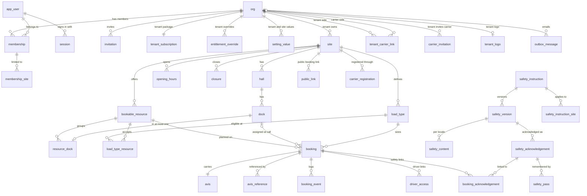

# Data model

Postgres 18. Schema `public` for tables, schema `app` for the RLS helper functions ([ADR-0002](../decisions/ADR-0002-tenancy-isolation-rls.md)). Each module owns its tables in `apps/api/src/modules/<module>/schema*.ts` ([ADR-0001](../decisions/ADR-0001-data-access-drizzle-node-postgres.md)).

## Conventions

- Primary keys: `id uuid not null default uuidv7()` unless stated.
- Timestamps: `timestamptz`. `created_at timestamptz not null default now()` on every table unless stated; it is omitted from the column lists below.
- `tenant_id` references `org(id)` of kind `tenant`. `carrier_id` references `org(id)` of kind `carrier`.
- Composite foreign keys such as `(site_id, tenant_id) → site(id, tenant_id)` keep a child inside its parent's tenant and site. Each referenced pair has a unique constraint.
- Enumerations are `text` with a `check` constraint, so adding a value is a generated migration.
- Every `tenant_id`, `carrier_id`, `site_id` and `booking_id` column has an index, alone or as the leading column of a composite index.
- Personal data: columns marked **PD** hold personal data and fall under the retention rules in [Retention](#retention).
- jsonb columns whose value may be JSON `null` (`entitlement_override.value`, `setting_value.value`) store it wrapped as `{ "v": <value> }`, with a check that the key exists. Drizzle writes a JS `null` as SQL NULL, so an unwrapped "unlimited" or "cleared" value would hit `not null`. Repositories wrap with `wrapJson` and read `.v` (`apps/api/src/db/ids.ts`).
- Implemented by U1: every table below exists in its schema file with its policies. A later unit changes a schema file only for a deviation its report lists.

## Policy classes

The policy helpers in `apps/api/src/db/rls.ts` generate these ([ADR-0002](../decisions/ADR-0002-tenancy-isolation-rls.md)). Every policy is for one party and starts with `(select app.party()) = '<party>' and`, because all parties connect as `rampflow_app` and `driver`, `carrier_at_tenant` and `public` scopes also set `app.tenant_id`. The predicates below omit that prefix. `site-scoped` adds `app.site_allowed(<site column>)` to the tenant policy. A party that needs `select ... for update` without the right to change a row gets a lock-only `update` policy (`with check false`). Every RLS table has an oracle entry in the party matrix test `apps/api/src/db/rls.test.ts`.

| Class | Tenant party | Other parties |
|---|---|---|
| `tenant-private` | all commands where `tenant_id = app.tenant_id()` | none |
| `tenant-reference(readers)` | all commands where `tenant_id = app.tenant_id()` | `select` for each listed reader: `carrier` where `app.linked_tenant(tenant_id)`; `carrier_at_tenant`, `driver` and `public` where `tenant_id = app.tenant_id()` |
| `booking-family` | all commands, site-scoped | `carrier`: `select` where `carrier_id = app.carrier_id()`. `carrier_at_tenant`: `select`, `insert` and `update` where `tenant_id = app.tenant_id() and carrier_id = app.carrier_id()`, on `booking` too: another carrier's bookings reach it only as load through the capacity read of [ADR-0004](../decisions/ADR-0004-booking-capacity-concurrency.md). `driver`: `select` where `booking_id = app.booking_id()` (`id` on `booking`), except on `avis` and `avis_reference`. |
| `none` | RLS disabled; imports restricted to the owning directory by Biome | |

SQL functions in schema `app` (baseline migration): the accessors `party()`, `user_id()`, `tenant_id()`, `carrier_id()`, `booking_id()`, `token_hash()`; the predicates `site_allowed(site)` and `linked_tenant(tenant)`; the security definer helpers `shares_org(user)` (the `app_user` policies) and `user_by_email(email)` (sign-in lookups by `anonymous`, `token` and `public`).

## Tables by module

| Module | Tables | Schema file | Unit |
|---|---|---|---|
| core | `org`, `app_user`, `session`, `auth_token`, `rate_limit_event`, `membership`, `membership_site`, `invitation`, `tenant_subscription`, `entitlement_override`, `setting_value`, `site`, `hall`, `dock`, `tenant_carrier_link`, `job_run` | `core/schema.ts` | U1 |
| notify | `outbox_message` | `notify/schema.ts` | U1 |
| booking | `bookable_resource`, `resource_dock`, `opening_hours`, `closure`, `load_type`, `load_type_resource` | `booking/schema.resources.ts` | U4 |
| booking | `booking`, `booking_event` | `booking/schema.ts` | U6 |
| booking | `carrier_invitation`, `carrier_registration`, `public_link` | `booking/schema.carriers.ts` | U7 |
| avis | `avis`, `avis_reference` | `avis/schema.ts` | U6 |
| driver | `driver_access` | `driver/schema.ts` | U6 |
| safety | `safety_instruction`, `safety_instruction_site`, `safety_version`, `safety_content`, `safety_acknowledgement`, `booking_acknowledgement`, `safety_attempt`, `safety_pass` | `safety/schema.ts` | U5 |
| brand | `tenant_logo` | `brand/schema.ts` | U3 |
| privacy | `privacy_request_log` | `privacy/schema.ts` | U11 |
| yard, report, i18n, integration | none | | |

## ER diagram

Columns are omitted. `tenant_id` edges to `org` exist on every tenant table and are drawn only where they carry meaning.

## core

### `org`

Every party organisation: the single platform org, tenants and carriers.

| Column | Type | Null | Notes |
|---|---|---|---|
| `id` | uuid | no | |
| `kind` | text | no | `platform`, `tenant`, `carrier` |
| `name` | text | no | 1 to 120 characters |
| `country` | char(2) | yes | ISO 3166-1, carriers (CR-02) |

- Unique `(id, kind)` for composite foreign keys. Partial unique index on `(kind)` where `kind = 'platform'`: exactly one platform org.
- RLS custom: `platform` all; `user` select where the user has a membership in it; `tenant`, `carrier_at_tenant`, `driver`, `public` select where `id = app.tenant_id()`; `tenant` also selects its linked carriers and the carrier org of each of its registrations (TN-04 shows the org a registration links); `carrier` select own org and linked tenants; `carrier_at_tenant` also selects its own carrier; `system` select; `user` and `token` insert where `kind = 'carrier'` (a carrier company created on acceptance or registration; ids are generated in the app, because these parties cannot read the new row back).

### `app_user`

| Column | Type | Null | Notes |
|---|---|---|---|
| `id` | uuid | no | |
| `email` | citext | no | unique; **PD** |
| `name` | text | no | **PD** |
| `locale` | text | yes | `de`, `en`, `pl` |
| `password_hash` | text | yes | `scrypt$N$r$p$salt$hash`; null for magic-link-only users |
| `email_verified_at` | timestamptz | yes | sign-in requires it |
| `last_seen_at` | timestamptz | yes | drives `privacy.retention.carrier_inactive_days` |
| `disabled_at` | timestamptz | yes | |

RLS custom: `platform` all; `user` select and update its own row (`id = app.user_id()`); `token` select and update the accepting user's row, and insert; `public` insert (registration); `tenant`, `carrier` and `carrier_at_tenant` select where `app.shares_org(id)`: members of the scope's org and, for a tenant, members of its linked carriers. Lookups by email before sign-in go through `app.user_by_email()`. Modules read names and emails with `userDisplay(tx, ids)` (`kernel/users.ts`).

### `session`

| Column | Type | Null | Notes |
|---|---|---|---|
| `id` | bytea | no | primary key, `sha256(token)` |
| `user_id` | uuid | no | FK `app_user` on delete cascade; indexed |
| `expires_at` | timestamptz | no | 30 days absolute |
| `last_seen_at` | timestamptz | no | idle limit 7 days |
| `user_agent` | text | yes | |

RLS: none.

### `auth_token`

Magic links and password resets.

| Column | Type | Null | Notes |
|---|---|---|---|
| `id` | uuid | no | |
| `kind` | text | no | `magic_link`, `password_reset` |
| `user_id` | uuid | no | FK `app_user` on delete cascade |
| `token_hash` | bytea | no | unique |
| `expires_at` | timestamptz | no | 15 min (magic link), 60 min (reset) |
| `used_at` | timestamptz | yes | single use |

RLS: none.

### `rate_limit_event`

| Column | Type | Null | Notes |
|---|---|---|---|
| `id` | bigint | no | identity |
| `bucket` | text | no | `login_failed`, `login_ip`, `magic_link_request`, `reset_request`, `driver_exchange`, `registration_request`, `registration_ip` (U7) |
| `key_hash` | bytea | no | hash of email and IP, or IP |
| `at` | timestamptz | no | |

Index `(bucket, key_hash, at)`. RLS: none.

### `membership`

| Column | Type | Null | Notes |
|---|---|---|---|
| `id` | uuid | no | |
| `user_id` | uuid | no | FK `app_user` on delete cascade |
| `org_id` | uuid | no | |
| `org_kind` | text | no | FK `(org_id, org_kind) → org(id, kind)` on delete cascade |
| `role` | text | no | one of `ROLES` |
| `created_by` | uuid | yes | FK `app_user` |

- Unique `(user_id, org_id)`: one role per membership.
- Check: `platform` org allows `platform_admin`; `tenant` org allows `tenant_admin`, `dispatcher`, `gate_operator`, `dock_operator`; `carrier` org allows `carrier_admin`, `carrier_user`.
- RLS custom: `user` select where `user_id = app.user_id()`; `platform` all; `tenant` all where `org_id = app.tenant_id()`; `carrier` all where `org_id = app.carrier_id()`.

### `membership_site`

Site list of gate and dock operators (TN-01). Other roles have no rows and see all sites.

| Column | Type | Null | Notes |
|---|---|---|---|
| `membership_id` | uuid | no | FK `membership` on delete cascade |
| `user_id` | uuid | no | denormalized for the `user` policy |
| `site_id` | uuid | no | |
| `tenant_id` | uuid | no | FK `(site_id, tenant_id) → site` |

Primary key `(membership_id, site_id)`. RLS: `tenant-private`; `user` select where `user_id = app.user_id()`.

### `invitation`

Staff, tenant admin and carrier user invitations (PL-01, TN-01, CR-04).

| Column | Type | Null | Notes |
|---|---|---|---|
| `id` | uuid | no | |
| `org_id`, `org_kind` | uuid, text | no | FK `→ org(id, kind)` on delete cascade |
| `email` | citext | no | **PD** |
| `role` | text | no | same check as `membership` |
| `site_ids` | uuid[] | no | default `{}`; copied to `membership_site` on acceptance |
| `token_hash` | bytea | no | unique |
| `invited_by` | uuid | yes | FK `app_user` |
| `expires_at` | timestamptz | no | 7 days |
| `accepted_at`, `accepted_user_id` | timestamptz, uuid | yes | |
| `revoked_at` | timestamptz | yes | |

Partial unique `(org_id, email)` where `accepted_at is null and revoked_at is null`. RLS custom: `platform` all; `tenant` all where `org_id = app.tenant_id()`; `carrier` all where `org_id = app.carrier_id()`; `token` select and update where `token_hash = app.token_hash()`.

### `tenant_subscription`

| Column | Type | Null | Notes |
|---|---|---|---|
| `tenant_id` | uuid | no | primary key, FK `org` on delete cascade |
| `package` | text | no | `start`, `pro`, `enterprise` |
| `updated_at`, `updated_by` | timestamptz, uuid | no | |

RLS custom: `platform` all; `tenant`, `carrier_at_tenant`, `driver`, `public` select where `tenant_id = app.tenant_id()`; `carrier` select where `app.linked_tenant(tenant_id)`.

### `entitlement_override`

| Column | Type | Null | Notes |
|---|---|---|---|
| `tenant_id` | uuid | no | FK `org` on delete cascade |
| `key` | text | no | implemented entitlement key, validated by `parseEntitlementOverride` |
| `value` | jsonb | no | `{ "v": true \| false \| non-negative integer \| null }`; `null` is unlimited |
| `expires_at` | timestamptz | yes | the override stops applying at this instant |
| `note` | text | yes | reason, shown in PL-02 |
| `updated_at`, `updated_by` | timestamptz, uuid | no | |

Primary key `(tenant_id, key)`. RLS custom: `platform` all; `tenant` select where `tenant_id = app.tenant_id()`. The `note` is internal, so carriers, drivers and the public never read overrides; `loadAccess` resolves their tenant's entitlements as the tenant (actor `system:access`).

### `setting_value`

| Column | Type | Null | Notes |
|---|---|---|---|
| `id` | uuid | no | |
| `tenant_id` | uuid | yes | null for platform rows |
| `site_id` | uuid | yes | set for site rows; FK `(site_id, tenant_id) → site` on delete cascade |
| `key` | text | no | setting key, validated by `parseSettingWrite` |
| `value` | jsonb | no | `{ "v": <value> }`, so a setting can be set to `null` (for example `privacy.notice_url`) |
| `updated_at`, `updated_by` | timestamptz, uuid | no | |

- `unique nulls not distinct (tenant_id, site_id, key)`; check `site_id is null or tenant_id is not null`.
- RLS custom: every party selects rows with `tenant_id is null`; `platform` writes them. `tenant` all where `tenant_id = app.tenant_id() and (site_id is null or app.site_allowed(site_id))`. `carrier_at_tenant`, `driver`, `public` select where `tenant_id = app.tenant_id()`. `carrier` selects where `app.linked_tenant(tenant_id)`.

### `site`

| Column | Type | Null | Notes |
|---|---|---|---|
| `id` | uuid | no | |
| `tenant_id` | uuid | no | FK `org` |
| `name` | text | no | |
| `address_line1`, `postal_code`, `city` | text | no | |
| `address_line2` | text | yes | |
| `country` | char(2) | no | ISO 3166-1 |
| `subdivision` | text | yes | ISO 3166-2, for example `DE-BY`; holiday import |
| `time_zone` | text | no | IANA, validated (MD-01) |
| `default_locale` | text | no | `de`, `en`, `pl` |
| `phone` | text | yes | E.164; shown after the carrier cutoff (BK-05) |
| `active` | boolean | no | default `true`; `core.max_sites` counts active sites |

Unique `(id, tenant_id)`. RLS: `tenant-reference(carrier, carrier_at_tenant, driver, public)`, site-scoped on `id`.

### `hall`

| Column | Type | Null | Notes |
|---|---|---|---|
| `id` | uuid | no | |
| `tenant_id`, `site_id` | uuid | no | FK `(site_id, tenant_id) → site` |
| `name` | text | no | |
| `sort` | integer | no | default 0 |

Unique `(id, site_id)`. RLS: `tenant-reference(carrier, carrier_at_tenant, driver)`, site-scoped.

### `dock`

| Column | Type | Null | Notes |
|---|---|---|---|
| `id` | uuid | no | |
| `tenant_id`, `site_id` | uuid | no | FK `(site_id, tenant_id) → site` |
| `hall_id` | uuid | no | FK `(hall_id, site_id) → hall(id, site_id)` |
| `code` | text | no | 1 to 16 characters, for example `D-03` |
| `door_type` | text | no | `dock_leveler`, `ground_level`, `side_loading`, `yard_open` |
| `temperature_zone` | text | no | `ambient`, `chilled`, `frozen` |
| `adr_allowed` | boolean | no | default `false` |
| `status` | text | no | `active`, `maintenance`, `inactive`; `core.max_docks` counts `active` and `maintenance` |
| `sort` | integer | no | |

Unique `(site_id, code)` and `(id, site_id)`. RLS: `tenant-reference(carrier, carrier_at_tenant, driver)`, site-scoped.

### `tenant_carrier_link`

| Column | Type | Null | Notes |
|---|---|---|---|
| `tenant_id` | uuid | no | FK `org` |
| `carrier_id` | uuid | no | FK `org`; indexed |
| `status` | text | no | `active`, `deactivated` (TN-03) |
| `source` | text | no | `invitation`, `public_link` |
| `deactivated_at` | timestamptz | yes | |

Primary key `(tenant_id, carrier_id)`. RLS custom: `tenant` all where `tenant_id = app.tenant_id()`; `carrier` select where `carrier_id = app.carrier_id()`; `carrier_at_tenant` select where both match. `app.linked_tenant()` reads this table under the caller's policies.

### `job_run`

| Column | Type | Null | Notes |
|---|---|---|---|
| `id` | bigint | no | identity |
| `job` | text | no | |
| `tenant_id` | uuid | yes | |
| `started_at` | timestamptz | no | |
| `finished_at` | timestamptz | yes | |
| `stats` | jsonb | no | counts only |

RLS: none.

## notify

### `outbox_message`

| Column | Type | Null | Notes |
|---|---|---|---|
| `id` | uuid | no | |
| `tenant_id` | uuid | yes | null for account emails |
| `template` | text | no | `<module>.<name>` |
| `to_email` | citext | no | **PD** |
| `locale` | text | no | staff or driver locale |
| `payload` | jsonb | no | **PD** possible |
| `dedupe_key` | text | yes | unique |
| `attempts` | integer | no | default 0 |
| `next_attempt_at` | timestamptz | no | default `now()` |
| `sent_at`, `failed_at` | timestamptz | yes | |
| `last_error` | text | yes | no addresses |

Partial index `(next_attempt_at)` where `sent_at is null and failed_at is null`. RLS custom: every party may `insert` with check `tenant_id is null or tenant_id = app.tenant_id()`; only `system` selects, updates and deletes.

## booking

### `bookable_resource`

| Column | Type | Null | Notes |
|---|---|---|---|
| `id` | uuid | no | |
| `tenant_id`, `site_id` | uuid | no | FK `(site_id, tenant_id) → site` |
| `kind` | text | no | `pool`, `single`; immutable |
| `name` | text | no | |
| `directions` | text[] | no | non-empty subset of `inbound`, `outbound` |
| `capacity_cap` | integer | yes | check `capacity_cap is null or (kind = 'pool' and capacity_cap >= 1)` |
| `daily_cap` | integer | yes | bookings starting per site-local day, check `>= 1` |
| `sort` | integer | no | order for automatic assignment |
| `active` | boolean | no | |

Unique `(id, kind)` and `(id, site_id)`. RLS: `tenant-reference(carrier, carrier_at_tenant, driver)`, site-scoped. Capacity writers lock the site with an advisory lock ([ADR-0004](../decisions/ADR-0004-booking-capacity-concurrency.md)), so no party needs a lock policy here.

### `resource_dock`

| Column | Type | Null | Notes |
|---|---|---|---|
| `dock_id` | uuid | no | primary key: a dock is in at most one resource |
| `resource_id` | uuid | no | |
| `resource_kind` | text | no | FK `(resource_id, resource_kind) → bookable_resource(id, kind)` on delete cascade |
| `site_id`, `tenant_id` | uuid | no | FKs `(dock_id, site_id) → dock`, `(resource_id, site_id) → bookable_resource` |

Partial unique `(resource_id)` where `resource_kind = 'single'`. Adding a dock that has a row returns 409 (MD-03). RLS: `tenant-reference(carrier_at_tenant)`, site-scoped.

### `opening_hours`

| Column | Type | Null | Notes |
|---|---|---|---|
| `id` | uuid | no | |
| `tenant_id`, `site_id` | uuid | no | |
| `resource_id` | uuid | yes | null: site hours; set: narrower resource hours (MD-04) |
| `weekday` | smallint | no | 1 (Monday) to 7 |
| `opens`, `closes` | time | no | local wall time, check `opens < closes`; `24:00` allowed for `closes` |

FK `(resource_id, site_id) → bookable_resource(id, site_id)` on delete cascade. RLS: `tenant-reference(carrier_at_tenant)`, site-scoped.

### `closure`

| Column | Type | Null | Notes |
|---|---|---|---|
| `id` | uuid | no | |
| `tenant_id`, `site_id` | uuid | no | |
| `resource_id` | uuid | yes | null: whole site |
| `kind` | text | no | `closed`, `blocked` |
| `starts_local`, `ends_local` | timestamp | no | local wall time, check `starts_local < ends_local` |
| `reason` | text | yes | |
| `source` | text | no | `manual`, `holiday` |
| `holiday_date` | date | yes | check `(source = 'holiday') = (holiday_date is not null)` |
| `holiday_name` | text | yes | |
| `reopened_at` | timestamptz | yes | a reopened holiday is ignored and never re-imported |
| `created_by` | uuid | yes | |

Partial unique `(site_id, holiday_date)` where `source = 'holiday'`; index `(site_id, starts_local)`. RLS: `tenant-reference(carrier_at_tenant)`, site-scoped.

### `load_type`

| Column | Type | Null | Notes |
|---|---|---|---|
| `id` | uuid | no | |
| `tenant_id`, `site_id` | uuid | no | |
| `name` | jsonb | no | `{ de, en }` (MD-05) |
| `direction` | text | no | `inbound`, `outbound` |
| `duration` | jsonb | no | `{ kind: 'fixed', minutes }` or `{ kind: 'tiers', tiers: [{ upTo: int \| null, minutes }] }`; tiers need `booking.duration_rules`, and without it a tiered type uses its largest tier |
| `buffer_minutes` | integer | no | 0 to 240, hidden from carriers |
| `carrier_bookable` | boolean | no | |
| `active` | boolean | no | |
| `sort` | integer | no | |

Unique `(id, site_id)`. Seeded per new site: "Parcel / van" fixed 15; "Palletised" tiers 16→30, 33→60, null→90; "Floor-loaded / loose" fixed 90. RLS: `tenant-reference(carrier, carrier_at_tenant, driver)`, site-scoped.

### `load_type_resource`

| Column | Type | Null | Notes |
|---|---|---|---|
| `load_type_id`, `resource_id` | uuid | no | primary key; FKs with `site_id` |
| `site_id`, `tenant_id` | uuid | no | |

RLS: `tenant-reference(carrier_at_tenant)`, site-scoped.

### `booking`

The booking and its visit ([Booking lifecycle](booking-lifecycle.md)). No personal data; it lives in `avis`.

| Column | Type | Null | Notes |
|---|---|---|---|
| `id` | uuid | no | |
| `tenant_id`, `site_id` | uuid | no | FK `(site_id, tenant_id) → site` |
| `resource_id` | uuid | no | FK `(resource_id, site_id) → bookable_resource` |
| `load_type_id` | uuid | no | FK `(load_type_id, site_id) → load_type` |
| `carrier_id` | uuid | yes | null for a free-text staff booking (BK-02) |
| `carrier_name` | text | no | company name snapshot or free text |
| `code` | char(8) | no | Crockford base32; unique `(tenant_id, code)`; the QR encodes only this |
| `status` | text | no | see lifecycle |
| `direction` | text | no | from the load type |
| `starts_at`, `ends_at`, `blocks_until` | timestamptz | no | check `starts_at < ends_at and ends_at <= blocks_until` |
| `site_time_zone` | text | no | snapshot |
| `load_units` | integer | no | sum of avis load units; drives tiered duration |
| `created_party` | text | no | `carrier`, `staff`; portal adoption KPI |
| `created_by` | uuid | yes | FK `app_user` |
| `client_request_id` | uuid | yes | partial unique `(created_by, client_request_id)`: idempotent create |
| `forced`, `walk_in` | boolean | no | |
| `dock_id` | uuid | yes | FK `(dock_id, site_id) → dock`; check: not null when status is `called`, `at_dock` or `loading` |
| `punctuality` | text | yes | `early`, `on_time`, `late` |
| `punctuality_minutes` | integer | yes | signed, against `starts_at` |
| `checked_in_at`, `called_at`, `at_dock_at`, `loading_at`, `done_at`, `departed_at`, `cancelled_at`, `no_show_at`, `turned_away_at` | timestamptz | yes | stamped by `transitionBooking` |
| `actual_load_units` | integer | yes | at `done` |
| `discrepancy_note` | text | yes | |
| `cancel_reason`, `departure_reason` | text | yes | |
| `cancelled_late` | boolean | no | default `false`; stamped by `cancel` after the cutoff, for the late-cancellation KPI |
| `turn_away_reason` | text | yes | `safety_not_completed`, `no_capacity`, `too_late`, `documents_missing`, `wrong_load`, `damaged`, `other` |
| `version` | integer | no | optimistic concurrency for edits |
| `updated_at` | timestamptz | no | |

Indexes:

- `booking_dock_occupied`: unique `(dock_id)` where `status in ('called', 'at_dock', 'loading')` ([ADR-0004](../decisions/ADR-0004-booking-capacity-concurrency.md)).
- `(resource_id, starts_at)` where `status in ('confirmed', 'checked_in', 'called', 'at_dock', 'loading', 'done')`: capacity and availability.
- `(tenant_id, site_id, starts_at)`: plan board, gate list, KPIs.
- `(carrier_id, starts_at)`: carrier list (CR-05).
- `(tenant_id, status, starts_at)` where `status = 'confirmed'`: no-show and reminder jobs.

Unique `(id, tenant_id)` for the children's composite foreign keys. RLS: `booking-family`; `driver` also has a lock-only `update` policy (`using id = app.booking_id()`, `with check false`), so `transitionBooking` can lock the booking for `link_acknowledgement`.

### `booking_event`

Append-only.

| Column | Type | Null | Notes |
|---|---|---|---|
| `id` | uuid | no | |
| `tenant_id`, `site_id` | uuid | no | |
| `booking_id` | uuid | no | FK `booking` on delete cascade; index `(booking_id, at)` |
| `carrier_id` | uuid | yes | |
| `type` | text | no | event type |
| `from_status`, `to_status` | text | yes | |
| `at` | timestamptz | no | |
| `actor_party` | text | no | `carrier`, `tenant`, `driver`, `system` |
| `actor_user_id` | uuid | yes | visible to tenant admins only |
| `actor_job` | text | yes | |
| `data` | jsonb | no | typed per event type |

FK `(booking_id, tenant_id) → booking(id, tenant_id)`. RLS: `booking-family` without `update`: the tenant selects, inserts and deletes (retention); `driver` also inserts where `booking_id = app.booking_id()` (`safety_linked`). RLS cannot tell a system actor from a user, so "only retention deletes" is a code convention.

### `carrier_invitation`

TN-03. A carrier company invited by a tenant.

| Column | Type | Null | Notes |
|---|---|---|---|
| `id` | uuid | no | |
| `tenant_id` | uuid | no | |
| `company_name` | text | no | |
| `email` | citext | no | **PD** |
| `token_hash` | bytea | no | unique |
| `invited_by` | uuid | no | |
| `expires_at` | timestamptz | no | 7 days |
| `accepted_at`, `accepted_carrier_id` | timestamptz, uuid | yes | |
| `revoked_at` | timestamptz | yes | |

Partial unique `(tenant_id, email)` while pending. RLS: `tenant-private`; `token` select and update by `token_hash`.

### `public_link`

| Column | Type | Null | Notes |
|---|---|---|---|
| `slug` | text | no | primary key, 10 random base32 characters |
| `tenant_id`, `site_id` | uuid | no | |
| `revoked_at` | timestamptz | yes | partial unique `(site_id)` where `revoked_at is null` |

The link answers only while `booking.public_link_enabled` resolves `true` for the site and `booking.public_link` is on (TN-04). RLS: none (routing lookup).

### `carrier_registration`

CR-02.

| Column | Type | Null | Notes |
|---|---|---|---|
| `id` | uuid | no | |
| `tenant_id`, `site_id` | uuid | no | |
| `company_name` | text | no | |
| `country` | char(2) | no | |
| `contact_name` | text | no | **PD** |
| `email` | citext | no | **PD** |
| `locale` | text | yes | `de`, `en`, `pl`: the form's language; the carrier's emails use it |
| `token_hash` | bytea | yes | unique; `sha256` of the emailed `registration` token |
| `expires_at` | timestamptz | yes | 24 hours after the registration |
| `user_id` | uuid | yes | the new or existing user |
| `carrier_id` | uuid | yes | the new or existing carrier org |
| `status` | text | no | `pending_email`, `pending_approval`, `approved`, `rejected` |
| `reject_reason` | text | yes | |
| `email_verified_at`, `decided_at` | timestamptz | yes | |
| `decided_by` | uuid | yes | |

Index `(tenant_id, status)`. Check: a `pending_email` row has `token_hash` and `expires_at`. RLS: `tenant-private`; `public` insert where `tenant_id = app.tenant_id()`; `carrier` select where `carrier_id = app.carrier_id()`; `token` select and update by `token_hash`. The verification claims the row with one guarded update while `status = 'pending_email'` and `expires_at > now`.

## avis

### `avis`

One per booking (AV-01). Excludes loading method, customs, SSCC and attachments.

| Column | Type | Null | Notes |
|---|---|---|---|
| `booking_id` | uuid | no | primary key, FK `booking` on delete cascade |
| `tenant_id`, `site_id` | uuid | no | |
| `carrier_id` | uuid | yes | |
| `counterparty_name` | text | no | supplier (inbound) or customer (outbound) |
| `load_units` | jsonb | no | `[{ type: LoadUnitType, quantity >= 1, stackable?, label? }]`, at least one |
| `pallet_positions` | integer | yes | |
| `gross_weight_kg` | numeric(8,1) | yes | required by `avis.require_gross_weight` |
| `pallet_exchange` | boolean | yes | |
| `vehicle_type` | text | yes | `VehicleType` |
| `plate` | text | yes | **PD**; uppercase, no separators; required by `booking.require_plate` |
| `plate_country` | char(2) | yes | |
| `trailer_plate` | text | yes | **PD** |
| `driver_name` | text | yes | **PD** |
| `driver_phone` | text | yes | **PD**; E.164; required by `avis.require_driver_phone` |
| `driver_locale` | text | yes | one of the 12 driver locales |
| `dangerous_goods` | jsonb | no | `{ present: false }` or `{ present: true, items: [{ unNumber: /^UN\d{4}$/, adrClass, packingGroup?, quantity?, unit? }] }` |
| `temperature` | jsonb | no | `{ controlled: false }` or `{ controlled: true, minC?, maxC? }` |
| `notes` | text | yes | up to 1,000 characters |
| `plate_seen` | text | yes | **PD**; recorded at check-in (YD-02) |
| `phone_erased_at`, `pseudonymized_at` | timestamptz | yes | retention markers |
| `updated_at` | timestamptz | no | |
| `updated_by` | uuid | yes | null when a job (retention) changed the row last |

FK `(booking_id, tenant_id) → booking(id, tenant_id)` on delete cascade. Indexes `(tenant_id, lower(driver_name))`, `(tenant_id, plate)`, `(tenant_id, driver_phone)` for YD-01 and TN-06 searches. RLS: `booking-family` without the `driver` read: the row holds the visit's personal data, and the driver view shows none of it (DR-01).

As built (U6a): the request schema `AvisInput` in `packages/shared/src/modules/avis/avis.ts` nests `vehicle` (`type`, `plate`, `plateCountry`, `trailerPlate`) and `driver` (`name`, `phone`, `locale`) and maps them onto the flat columns; `references` become `avis_reference` rows with `value_norm` uppercase and trimmed. A walk-in turned away without an avis (YD-03) stores a row with `counterparty_name = ''`, `load_units = []` and only `plate_seen`.

### `avis_reference`

| Column | Type | Null | Notes |
|---|---|---|---|
| `id` | uuid | no | |
| `booking_id` | uuid | no | FK `avis` on delete cascade |
| `tenant_id`, `site_id` | uuid | no | |
| `carrier_id` | uuid | yes | |
| `type` | text | no | `REFERENCE_TYPES` |
| `value` | text | no | 1 to 35 characters |
| `value_norm` | text | no | uppercase, trimmed; index `(tenant_id, value_norm)` for YD-01 search and `avis.unique_references` |

RLS: `booking-family` without the `driver` read.

## driver

### `driver_access`

| Column | Type | Null | Notes |
|---|---|---|---|
| `id` | uuid | no | input of the HMAC that derives the token |
| `tenant_id`, `booking_id` | uuid | no | FK `(booking_id, tenant_id) → booking` on delete cascade |
| `site_id` | uuid | no | the booking's site, so the tenant policy is site-scoped like its siblings |
| `carrier_id` | uuid | yes | |
| `token_hash` | bytea | no | unique, `sha256(token)` |
| `channel` | text | no | `link`, `staff` |
| `created_by` | uuid | yes | |
| `expires_at` | timestamptz | no | |
| `revoked_at`, `last_used_at` | timestamptz | yes | |

Partial unique `(booking_id)` where `channel = 'link' and revoked_at is null`. RLS: `booking-family`; `token` select and update by `token_hash`.

## safety

### `safety_instruction`

| Column | Type | Null | Notes |
|---|---|---|---|
| `id` | uuid | no | |
| `tenant_id` | uuid | no | |
| `name` | text | no | internal name |
| `all_sites` | boolean | no | |
| `archived_at` | timestamptz | yes | `safety.max_briefing_templates` counts unarchived rows |

RLS: `tenant-reference(driver)`.

### `safety_instruction_site`

`instruction_id`, `site_id`, `tenant_id`; primary key `(instruction_id, site_id)`. RLS: `tenant-reference(driver)`.

### `safety_version`

| Column | Type | Null | Notes |
|---|---|---|---|
| `id` | uuid | no | |
| `tenant_id`, `instruction_id` | uuid | no | |
| `version` | integer | no | unique `(instruction_id, version)` |
| `status` | text | no | `draft`, `published`, `retired`; partial unique `(instruction_id)` per `draft` and per `published` |
| `material_change` | boolean | no | publishing invalidates earlier acknowledgements (SF-01) |
| `published_at`, `published_by` | timestamptz, uuid | yes | |

RLS: `tenant-private`; `driver` select where `status <> 'draft'` and same tenant, so a driver session can compute the material floor and read the version of an older acknowledgement (U5).

### `safety_content`

| Column | Type | Null | Notes |
|---|---|---|---|
| `version_id` | uuid | no | FK `safety_version` on delete cascade |
| `locale` | text | no | primary key `(version_id, locale)` |
| `tenant_id` | uuid | no | |
| `title` | text | no | |
| `blocks` | jsonb | no | `[{ kind: 'text', text } \| { kind: 'pictogram', id }]` |
| `questions` | jsonb | no | `[{ id, prompt, options: string[], correct: int }]`; 3 to 5 per published locale with `safety.quiz` |
| `statement` | text | no | confirmation text shown before ticking |
| `translation` | text | no | `source`, `machine`, `reviewed` |
| `content_hash` | bytea | no | sha256 of canonical JSON of title, blocks, questions, statement |

Rows of a published version are immutable (the API refuses writes; SF-01). RLS: `tenant-private`; `driver` select where the version is `published` and same tenant.

### `safety_acknowledgement`

| Column | Type | Null | Notes |
|---|---|---|---|
| `id` | uuid | no | |
| `tenant_id`, `instruction_id`, `version_id` | uuid | no | |
| `locale` | text | no | |
| `content_hash` | bytea | no | |
| `booking_id` | uuid | yes | FK `booking` on delete set null |
| `carrier_id` | uuid | yes | |
| `driver_name` | text | no | **PD**; typed by the driver |
| `statement_shown` | text | no | |
| `channel` | text | no | `link`, `staff` |
| `score` | integer | yes | percent, with `safety.quiz` |
| `attempts` | integer | no | |
| `completed_at` | timestamptz | no | |
| `expires_at` | timestamptz | yes | from `safety.validity_days`; null means this visit only |
| `restricted_at`, `pseudonymized_at` | timestamptz | yes | TN-06, PL-05 |

Indexes `(tenant_id, completed_at)`, `(tenant_id, lower(driver_name))`. RLS: `tenant-private` (tenant-wide, not site-scoped: an acknowledgement counts across the tenant's sites); `driver` insert with check and select where `booking_id = app.booking_id()`.

### `booking_acknowledgement`

| Column | Type | Null | Notes |
|---|---|---|---|
| `booking_id` | uuid | no | FK `booking` on delete cascade |
| `instruction_id` | uuid | no | primary key `(booking_id, instruction_id)` |
| `acknowledgement_id` | uuid | no | FK `safety_acknowledgement` |
| `tenant_id`, `site_id` | uuid | no | |
| `via` | text | no | `completed`, `pass`, `gate_lookup` |
| `linked_by_party` | text | no | |
| `linked_by_user_id` | uuid | yes | |

RLS: `tenant-private` site-scoped; `driver` insert, select and update where `booking_id = app.booking_id()` (the update lets `link_acknowledgement` relink a repeated briefing; U5).

### `safety_attempt`

Quiz attempt counter per booking and version (SF-04).

`booking_id`, `version_id`, `tenant_id`, `attempts integer`, `last_score integer`, `passed_at timestamptz null`; primary key `(booking_id, version_id)`. RLS: `tenant-private`; `driver` all where `booking_id = app.booking_id()`.

### `safety_pass`

| Column | Type | Null | Notes |
|---|---|---|---|
| `device_hash` | bytea | no | `sha256(rf_device cookie)` |
| `tenant_id`, `instruction_id` | uuid | no | primary key `(device_hash, tenant_id, instruction_id)` |
| `acknowledgement_id` | uuid | no | FK `safety_acknowledgement` on delete cascade |
| `expires_at` | timestamptz | yes | the acknowledgement's expiry |

RLS: `tenant-private`; `driver` insert where `tenant_id = app.tenant_id()`.

## brand

### `tenant_logo`

| Column | Type | Null | Notes |
|---|---|---|---|
| `tenant_id` | uuid | no | primary key |
| `content_type` | text | no | `image/png`, `image/jpeg`; checked by magic bytes, SVG rejected (TN-05) |
| `bytes` | bytea | no | |
| `byte_size` | integer | no | check `<= 262144` |
| `sha256` | bytea | no | cache key in the logo URL |
| `updated_at`, `updated_by` | timestamptz, uuid | no | |

RLS: `tenant-reference(carrier, carrier_at_tenant, driver, public)`.

## privacy

### `privacy_request_log`

| Column | Type | Null | Notes |
|---|---|---|---|
| `id` | uuid | no | |
| `tenant_id` | uuid | no | |
| `kind` | text | no | `export`, `erase` |
| `matched_bookings`, `matched_acknowledgements` | integer | no | counts only; search terms are not stored |
| `actor_user_id` | uuid | no | |

RLS: `tenant-private`.

## Retention

The retention job (PL-05) applies these rules per tenant with the resolved `privacy.retention.*` settings. Every rule is set-based and idempotent.

| Data | Rule | Setting |
|---|---|---|
| `avis.driver_phone` | set NULL and stamp `phone_erased_at` this many days after the booking reaches a final state | `driver_phone_days` |
| `avis.driver_name`, `plate`, `trailer_plate`, `plate_seen` | replace with NULL and stamp `pseudonymized_at` | `driver_identity_days` |
| `booking` with children | delete | `visit_days` |
| `safety_acknowledgement` | pseudonymize `driver_name` after `expires_at` (or completion for per-visit) plus the setting; restricted rows follow the same rule | `safety_after_expiry_days` |
| `booking_event` | delete | `audit_log_days` |
| `driver_access` | delete rows past `expires_at` | `driver_link_hours` sets the expiry |
| carrier users without sign-in | email notice 30 days ahead, then delete the user and empty carrier orgs | `carrier_inactive_days` |
| `rate_limit_event`, used `auth_token` | delete after 24 hours | fixed |
| `outbox_message` | the worker empties `payload` when it sends; delete sent or failed rows after 7 days | fixed |

Interpretations as built (U11):

- The visit rule deletes bookings by `starts_at` older than `privacy.retention.visit_days`, in any status.
- Pseudonymized acknowledgements keep the row with `driver_name = ''`, because the column is `not null`.
- A carrier user who is still the creator of a booking is anonymized and disabled instead of deleted. A carrier org still referenced by bookings or tenant links is kept without members.
- Inactive carrier accounts get a `privacy.inactive-notice` email 30 days before deletion.

TN-06 erase calls the same pseudonymization function for the matched bookings, and sets `restricted_at` on matched acknowledgements that are still under retention.

As built (U11), in `apps/api/src/modules/privacy/retention/rules.ts` and `privacy/jobs/retention.ts`:

- A booking's end is its final-state time: `coalesce(departed_at, turned_away_at, cancelled_at, no_show_at)` while its status is `departed`, `cancelled`, `no_show` or `turned_away`. The phone and identity rules count from that end. An active booking keeps its avis until the visit rule removes it.
- Pseudonymization sets `driver_name`, `driver_phone`, `plate`, `trailer_plate` and `plate_seen` to NULL. It stamps `pseudonymized_at`, and it stamps `phone_erased_at` when a phone was still there. The identity rule therefore also covers a phone whose own limit is longer.
- The visit rule deletes bookings whose `starts_at` lies more than `visit_days` in the past, in any status. The children go by cascade, and `safety_acknowledgement.booking_id` becomes NULL.
- An acknowledgement's retention ends at `coalesce(expires_at, completed_at) + safety_after_expiry_days`. Pseudonymization replaces `driver_name` with an empty string, because the column is `not null`.
- Expired unused `auth_token` rows go 24 hours after `expires_at`, like used ones.
- A carrier user is "without sign-in" when every membership is a carrier membership and `coalesce(last_seen_at, created_at)` is older than the limit. The notice is `privacy.inactive-notice` with `dedupe_key = inactive-notice:<user id>:<deadline>`, so a sign-in makes a new notice due. Deletion runs as the platform party. A user that a foreign key still references (for example `booking.created_by`) cannot be deleted. That user loses the memberships, `disabled_at` is set, and the email, name, locale and password are overwritten instead. A carrier org without members is deleted unless bookings or tenant links still reference it.
- `pnpm retention:run` runs one tick and prints the counts. The `job_run` row holds the same counts.
