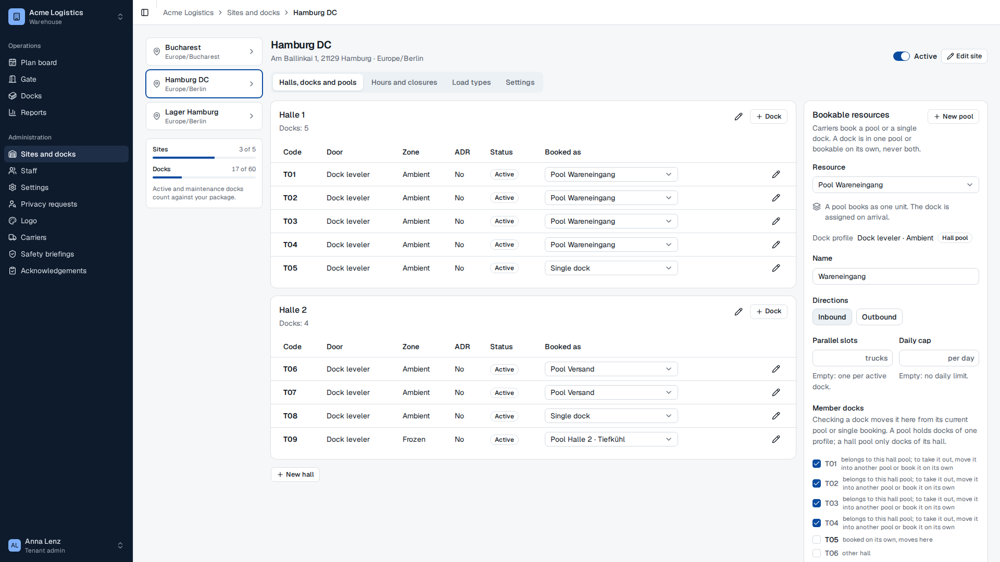
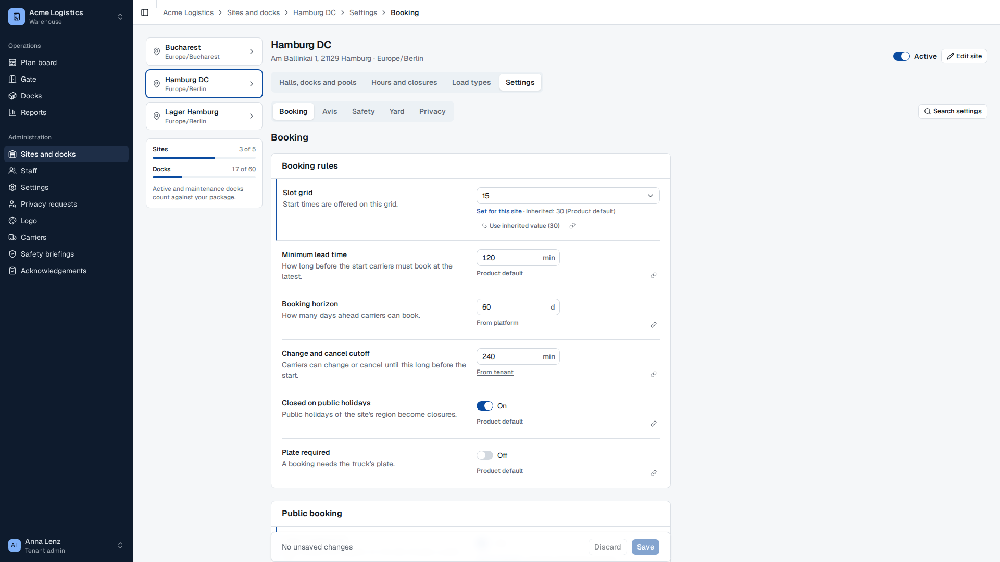
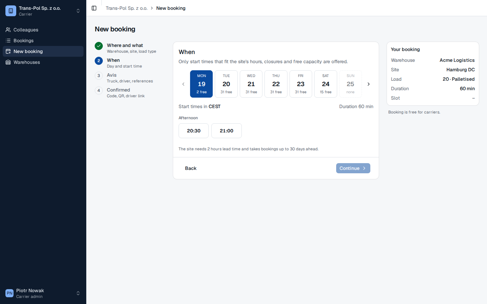
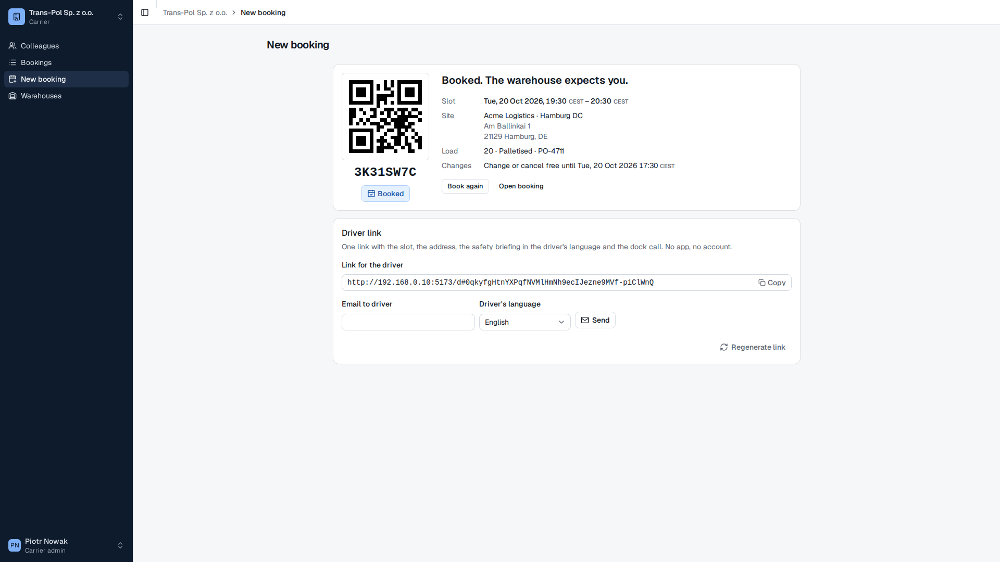
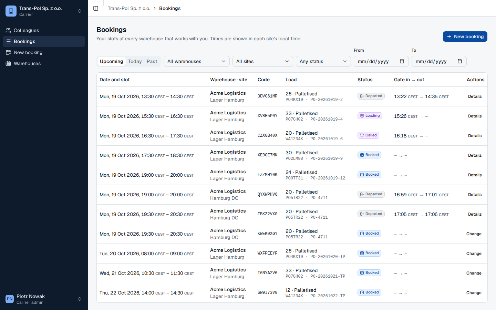
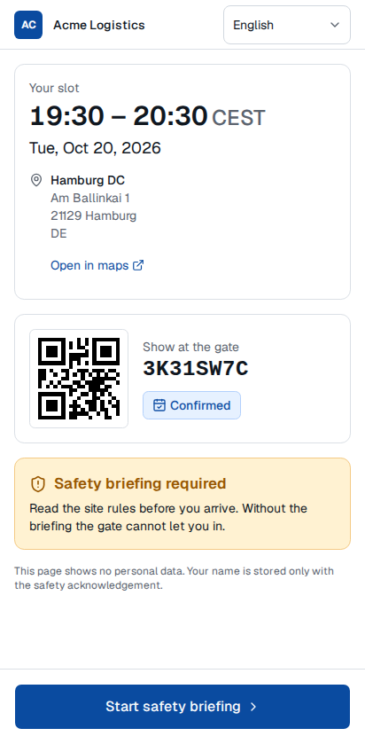
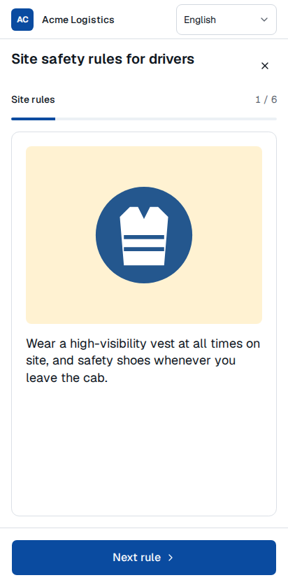
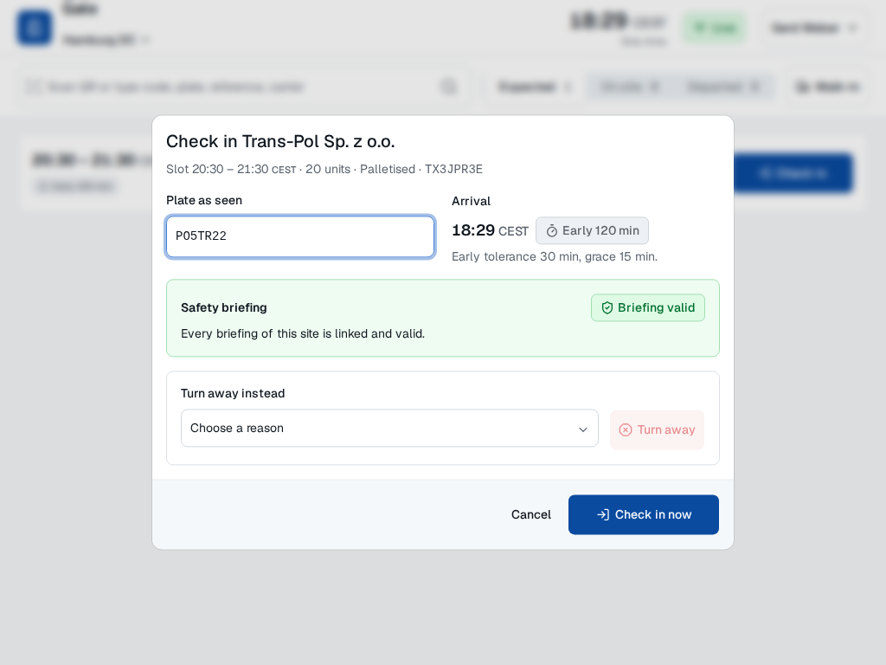
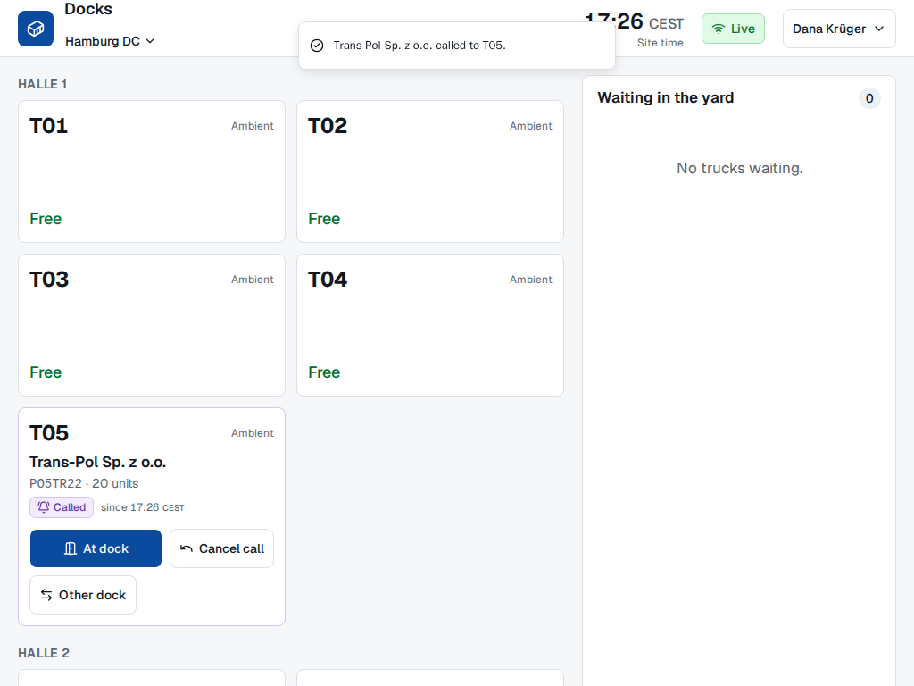
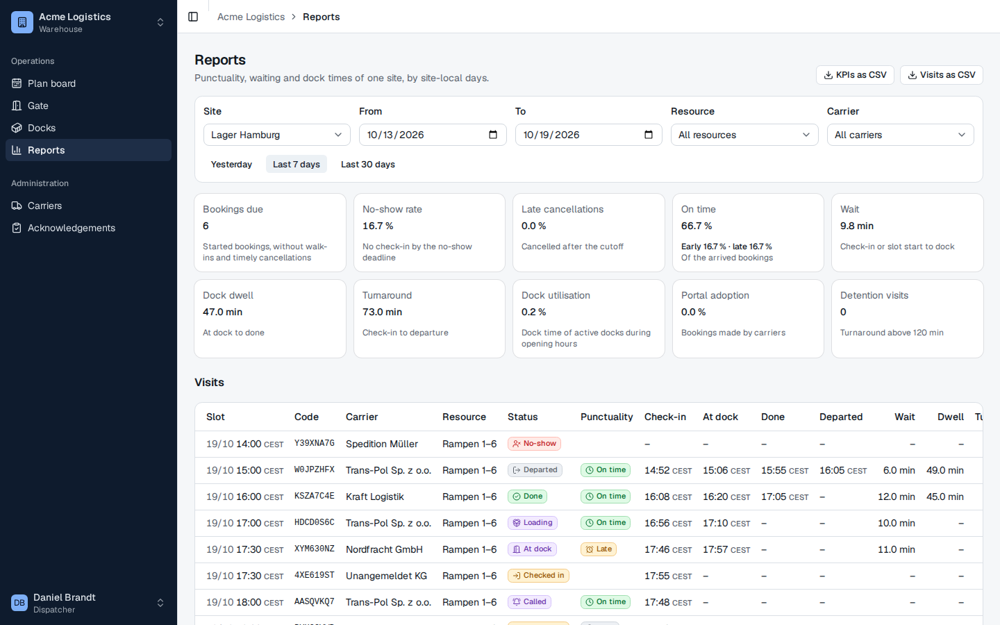

# Your first truck, end to end

In this tutorial we move one truck through rampflow from the booking to the departure. We play every person on the way: the warehouse admin, the carrier, the driver, the gate operator and the dock operator. At the end, the truck shows up in the KPIs of the site.

We use the demo data of `pnpm db:seed`. Every demo account has the password `rampflow-demo`.

| Account | Who it is |
|---|---|
| `admin@acme.local` | Anna Lenz, tenant admin of the warehouse operator Acme Logistics |
| `admin@trans-pol.local` | Piotr Nowak, admin of the carrier Trans-Pol Sp. z o.o. |
| `gate@acme.local` | Gerd Weber, gate operator at Acme |
| `dock@acme.local` | Dana Krüger, dock operator at Acme |
| `dispatch@acme.local` | Daniel Brandt, dispatcher at Acme |

The whole run takes about 20 minutes.

## Start rampflow

1. In the repository root, start Postgres and Mailpit, then install, migrate and seed:

   ```sh
   pnpm db:up
   pnpm install
   pnpm db:setup && pnpm db:migrate
   pnpm db:seed
   ```

   The last line of `pnpm db:seed` reads `Seeded core, sites, safety, booking, carriers, portal`.

2. Start the apps:

   ```sh
   pnpm dev
   ```

   Wait for the line `rampflow api listening on http://localhost:3000`.

3. Open <http://localhost:5173> in your browser. The sign-in page opens.

In a git worktree, the ports differ. Run `node scripts/checkout-env.mjs` and use the `WEB_PORT` it prints. [Run rampflow locally](../how-to/run-locally.md) has the details.

The tutorial switches between accounts. To change the account, open the user menu (bottom left in the sidebar, top right on the gate and dock screens) and select **Sign out**.

## Look at the warehouse as the tenant admin

1. Sign in as `admin@acme.local`. The **Plan board** opens.

   The demo accounts start in German, and Piotr Nowak starts in Polish. This tutorial uses the English labels.

2. Open the user menu, select **Sprache**, then **English**. The app switches to English, and rampflow stores the choice for this account. If the account already shows English, skip this step. Do the same for every account below.
3. Select **Sites and docks** in the sidebar. The page lists three sites: Bucharest, Hamburg DC and Lager Hamburg.
4. Select **Hamburg DC**. The tab **Halls, docks and pools** opens.



Look at the **Booked as** column. Every dock is in exactly one pool or booked on its own. Docks T01 to T04 are booked as **Pool Wareneingang**, T06 and T07 as **Pool Versand**, and T05 and T08 as **Single dock**. T09 is the frozen dock of Halle 2. It is booked as **Pool Halle 2 · Tiefkühl**, because a pool only holds docks with the same door type, temperature zone and ADR flag.

On the right, **Bookable resources** shows the pool Wareneingang with its dock profile, **Dock leveler · Ambient**, and the **Hall pool** badge, and lists its member docks. A carrier books the pool, and the dock operator picks a free member dock when the truck arrives.

5. Select the tab **Settings** of Hamburg DC. The topic **Booking** opens.



Each setting shows where its value comes from. **Booking horizon** says **From platform**, and **Change and cancel cutoff** says **From tenant**. **Slot grid** says **Set for this site** and shows the value it would inherit, **Inherited: 30 (Product default)**. **Public booking link** says **Set for this site** too, because the seed switched it on for this site. The booking rules tell us what the carrier sees next: start times on a 15-minute grid, at least 120 minutes ahead.

## Book a slot as the carrier

1. Sign out, and sign in as `admin@trans-pol.local`. Switch the language to English in the user menu (**Język**, then **English**).
2. Select **New booking** in the sidebar.
3. In **Where and what**, keep the warehouse **Acme Logistics**. Under **Site**, select **Hamburg DC**.
4. Select the load type **Palletised**, enter `20` in **Load units**, and select **Continue**.

   The summary on the right now shows **Duration 60 min**: at Hamburg DC, 20 pallets take one hour.

5. In **When**, select the first day that shows free times. The start times appear below the days.



6. Select the first start time, then **Continue**.
7. In **Avis**, enter these values:

   | Field | Value |
   |---|---|
   | **Reference 1** | `PO-4711` |
   | **Supplier** | `Elektro Nord AG` |
   | **Plate** | `PO 5TR22` |
   | **Plate country** | `PL` |
   | **Driver name** | `Tomasz Wiśniewski` |
   | **Driver language** | English |

8. Select **Confirm booking**.



The page says **Booked. The warehouse expects you.** Note the booking code under the QR code. We need it at the gate. The **Driver link** card holds one link for the driver.

9. Select **Copy** next to **Link for the driver**.
10. Select **Bookings** in the sidebar. The new booking is in the list with the status **Booked**, next to the bookings the seed made for Trans-Pol.



## Complete the briefing as the driver

The driver has no account. The link is all the driver needs.

1. Open a private browser window, so the driver's session stays apart from Piotr's.
2. Open the developer tools, turn on the device toolbar, and select a phone, for example **Pixel 7**.
3. Paste the driver link into the address bar and open it. The address changes to `/d/`, because the app has exchanged the link for a cookie.



The page shows the slot in site time, the address of Hamburg DC, the booking code with its QR code, and **Safety briefing required**.

4. Select **Start safety briefing**.



5. Read each rule and select **Next rule** until the sixth rule. Then select **I have read this. Go to the quiz**.
6. Answer the three questions: **10 km/h**, **In the waiting area** and **When the staff release me**. Select **Check answers**.

   If an answer is wrong, the briefing starts again from the first rule. Read the rules again and retry.

7. Under **Your name**, enter `Tomasz Wiśniewski`. Tick the confirmation and select **Confirm briefing**.

The booking page returns and shows **Safety briefing valid until** with a date one year ahead. Keep this window open.

## Check the truck in at the gate

1. In the main window, sign out and sign in as `gate@acme.local`. Switch the language to English.
2. Select **Gate** in the sidebar. The gate screen opens in the station layout, without a sidebar.
3. Select the site name in the header and choose **Hamburg DC**.
4. Type the booking code into the search field and press Enter. The check-in dialog opens.



The dialog shows the plate `PO5TR22`, the arrival time, and the badge **Early**, because the truck arrives before its slot. The **Safety briefing** box says **Briefing valid**: the gate sees the briefing that the driver just completed.

5. Select **Check in now**. A message says that Trans-Pol is checked in, and the tab **On site** counts 1.

On a busy day, the gate screen lists every truck on site with its punctuality, waiting time, dock and briefing status. The seed's site Lager Hamburg has such a day:


## Call the truck to a dock

1. Sign out, and sign in as `dock@acme.local`. Switch the language to English.
2. Select **Docks** in the sidebar, then choose **Hamburg DC** in the header.

   The truck waits under **Waiting in the yard**.

3. Select **Call to dock**. The dialog suggests the free docks of the pool Wareneingang.
4. Keep **T01** and select **Call to T01**.



5. Switch to the driver's window. Within 15 seconds, the phone shows **Go to dock T01, hall Halle 1**. To see it at once, reload the page.


## Load the truck

Back on the dock screen, the card of T01 shows the truck.

1. Select **At dock**. The truck has docked.
2. Select **Loading**.
3. Select **Done**. The dialog shows **Actual load units** with the announced 20.
4. Select **Done** in the dialog. T01 is free again.

## Check the truck out

1. Sign out, and sign in as `gate@acme.local`. Select **Gate**, then **Hamburg DC** if the header shows another site.
2. Select the tab **On site**. The card shows the dock T01 and the status **Done**.
3. Select **Check out**, then **Check out** in the dialog.

The tab **Departed** now holds the truck. The driver link stops working 24 hours after the departure (`privacy.retention.driver_link_hours`).

## Read the KPIs

1. Sign out, and sign in as `dispatch@acme.local`. Switch the language to English.
2. Select **Reports** in the sidebar.
3. Under **Site**, select **Hamburg DC**. If the slot of your booking is on a later day, set **To** to that day.

The **Visits** table lists your truck with its code, the resource Wareneingang, the status **Departed**, **Early**, and the times of check-in, docking, completion and departure. The KPI cards above count it. **Portal adoption** is 100 %, because a carrier booked it. **Bookings due** counts only slots that have started, so it leaves your truck out until its slot begins.

4. Under **Site**, select **Lager Hamburg** to see a full demo day.



## What we did

We followed one truck through the core loop of rampflow:

1. The tenant admin's site offers a pool of docks to carriers.
2. The carrier booked a slot with the avis and got one link for the driver.
3. The driver completed the safety briefing on the phone, before arrival.
4. The gate saw the valid briefing and checked the truck in.
5. The dock operator called the truck, and the driver's phone showed the dock.
6. The dock recorded loading, and the gate checked the truck out.
7. The timestamps became the KPIs of the site.

To go further:

- [Set up a site for booking](../how-to/set-up-a-site.md) shows how the pools, hours and load types of Hamburg DC came about.
- [Plan the day on the plan board](../how-to/plan-the-day.md) shows the dispatcher's view of the same bookings.
- [MVP scope](../explanation/mvp-scope.md) lists every story behind these screens.

The screenshots in this tutorial come from `pnpm docs:screens`, which runs these steps against a running `pnpm dev`.
